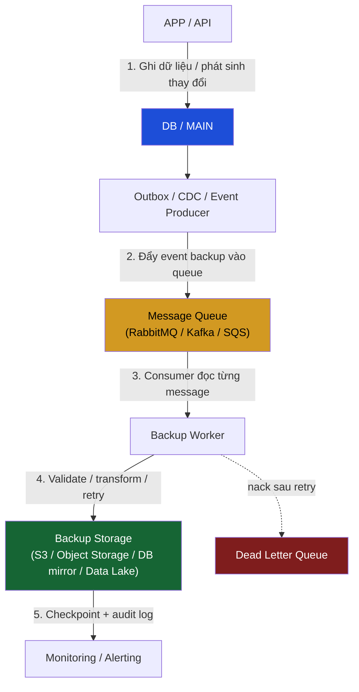

# /cdc-backup — Event-Driven Backup Pipeline (CDC → Queue → Worker → Storage)

> *"Một bản backup chưa từng restore thử = không tồn tại."*
> **Trigger**: user muốn thiết kế backup liên tục (near-real-time) theo kiến trúc event-driven —
> mỗi thay đổi dữ liệu được phát thành event, đẩy qua message queue, worker ghi vào backup storage.
> Khác với snapshot theo lịch (rclone/pg_dump cron) ở [[push-backup-gdrive]] — cái đó chụp toàn bộ
> theo giờ; cái này bắt **từng thay đổi** ngay khi nó xảy ra → RPO tính bằng giây, không phải giờ.

Dùng chung queue với [[rabbitmq]], alerting với [[monitoring]], snapshot định kỳ với
[[push-backup-gdrive]] / [[pull-backup-gdrive]]. Ba lớp bổ sung nhau, không thay thế nhau.

---

## Kiến trúc (theo sơ đồ)



**Nguyên tắc cốt lõi:**
1. **App KHÔNG tự ghi backup trực tiếp** — chỉ ghi DB + phát event. Backup là hệ quả bất đồng bộ,
   không nằm trên critical path của request (không làm chậm user).
2. **Outbox/CDC là source of truth cho event** — không dùng `go func(){ publish }()` fire-and-forget
   ngay trong handler (mất event nếu app crash sau commit DB, trước publish). Xem "Chọn Producer".
3. **Queue tách producer khỏi consumer** — DB spike không làm sập backup, backup chậm không làm sập DB.
4. **Worker phải idempotent** — cùng 1 event xử lý 2 lần cho cùng kết quả (queue at-least-once).
5. **Mọi event có checkpoint + audit** — biết đã backup tới đâu, thiếu event nào, để resume/replay.

---

## 0. Discovery — hỏi trước khi thiết kế

| # | Câu hỏi | Ảnh hưởng |
|---|---------|-----------|
| D1 | **RPO** chấp nhận được? (mất tối đa bao nhiêu dữ liệu — giây/phút/giờ) | RPO giây → CDC/outbox liên tục. RPO giờ → snapshot cron là đủ, không cần pipeline này |
| D2 | **RTO** — restore trong bao lâu? | RTO ngắn → cần backup dạng restorable (DB mirror), không chỉ raw event log |
| D3 | DB engine? (Postgres / MySQL / Mongo) | Chọn CDC tool: Postgres logical replication / Debezium / Mongo change streams |
| D4 | Queue đã có sẵn chưa? (RabbitMQ / Kafka / SQS) | Kafka có retention + replay sẵn; RabbitMQ cần DLQ + outbox cẩn thận; SQS managed |
| D5 | Backup storage đích? (S3 / MinIO / DB mirror / Data Lake) | Quyết định format: event log (append) vs materialized mirror (apply) |
| D6 | Thứ tự event có quan trọng không? (vd financial ledger) | Có → cần ordering key (Kafka partition / per-entity queue). Không → parallel tự do |
| D7 | Dữ liệu nhạy cảm (PII, payment)? | Cần encrypt at-rest + in-transit, redact trước khi log event body |
| D8 | Đã có snapshot định kỳ chưa? | Nếu chưa → làm [[push-backup-gdrive]] TRƯỚC (baseline), pipeline này là lớp incremental phủ lên |

> **Quy tắc:** RPO > 1 giờ và dữ liệu nhỏ → KHÔNG cần pipeline này, snapshot cron rẻ hơn nhiều.
> Chỉ dùng event-driven khi mất vài phút dữ liệu là không chấp nhận được.

---

## 1. Backup Strategy — nền tảng (áp dụng cho mọi pipeline)

### 1.1 Quy tắc 3-2-1

```
3 bản sao dữ liệu  →  DB gốc + 2 backup
2 loại phương tiện →  vd Object Storage (S3) + DB mirror khác vùng
1 bản off-site     →  khác region / khác provider (chống mất cả datacenter)
```

Pipeline event-driven này lo **1 bản incremental liên tục**. Vẫn cần:
- 1 **full snapshot định kỳ** (baseline để restore nhanh — [[push-backup-gdrive]])
- 1 bản **off-site** (region/provider khác — [[pull-backup-gdrive]] sync sang VPS/bucket khác)

### 1.2 Backup type

| Loại | Là gì | Khi dùng |
|---|---|---|
| **Full** | Toàn bộ dữ liệu | Baseline hàng ngày/tuần — restore point khởi đầu |
| **Incremental** | Chỉ thay đổi từ backup trước | Pipeline này — event-driven, liên tục |
| **Differential** | Thay đổi từ full gần nhất | Trung gian — ít dùng nếu đã có incremental liên tục |

**Restore = Full baseline gần nhất + replay incremental events tới thời điểm cần** (point-in-time recovery).

### 1.3 RPO / RTO — chọn tần suất theo mục tiêu, không theo cảm tính

| RPO mục tiêu | Cơ chế phù hợp |
|---|---|
| < 1 phút | CDC/outbox event-driven (pipeline này) + WAL archiving |
| ~ 1 giờ | Snapshot cron mỗi giờ |
| ~ 1 ngày | Snapshot cron hàng ngày ([[push-backup-gdrive]]) |

---

## 2. Chọn Producer — Outbox vs CDC (bước quan trọng nhất)

**Vấn đề dual-write:** nếu handler làm `db.Commit()` rồi `mq.Publish()` — app crash giữa 2 bước →
DB đã ghi nhưng event mất → backup thiếu vĩnh viễn, không ai biết. Không bao giờ để backup phụ thuộc
vào một `publish` best-effort sau commit.

### 2.1 Transactional Outbox (khuyến nghị cho app tự viết)

Ghi event vào bảng `outbox` **trong cùng transaction** với thay đổi dữ liệu. Một tiến trình riêng
(relay) đọc bảng outbox và publish lên queue.

```sql
CREATE TABLE outbox (
    id           BIGSERIAL PRIMARY KEY,
    aggregate    TEXT NOT NULL,          -- 'orders', 'users'...
    aggregate_id TEXT NOT NULL,          -- id bản ghi bị thay đổi
    event_type   TEXT NOT NULL,          -- 'created' | 'updated' | 'deleted'
    payload      JSONB NOT NULL,         -- snapshot bản ghi sau thay đổi
    created_at   TIMESTAMPTZ NOT NULL DEFAULT NOW(),
    published_at TIMESTAMPTZ             -- NULL = chưa relay lên queue
);
CREATE INDEX idx_outbox_unpublished ON outbox(id) WHERE published_at IS NULL;
```

```go
// Trong service — CÙNG transaction với business write
tx, _ := db.Begin()
tx.Exec("UPDATE orders SET status=$1 WHERE id=$2", status, orderID)
tx.Exec(`INSERT INTO outbox (aggregate, aggregate_id, event_type, payload)
         VALUES ('orders', $1, 'updated', $2)`, orderID, payloadJSON)
tx.Commit()   // DB + outbox atomic — không bao giờ lệch nhau
```

Relay (goroutine hoặc job riêng) poll outbox → publish → set `published_at`. Nếu relay crash, event
vẫn nằm trong outbox → chạy lại là publish tiếp (không mất).

### 2.2 CDC (Change Data Capture) — không cần sửa app

Đọc trực tiếp **WAL / binlog** của DB → phát event. Dùng khi không muốn/không thể sửa code app.

| DB | CDC tool |
|---|---|
| Postgres | Debezium (Kafka Connect), hoặc `pgoutput` logical replication |
| MySQL/MariaDB | Debezium binlog connector |
| MongoDB | Change Streams (native) |

**Outbox vs CDC:**
- **Outbox** — kiểm soát payload (chỉ backup field cần), app-level, thêm 1 bảng. Tốt cho app tự viết.
- **CDC** — bắt mọi thay đổi kể cả migration/manual SQL, không sửa app, nhưng payload là raw row +
  phải vận hành thêm Debezium/connector. Tốt cho legacy / nhiều app ghi chung DB.

---

## 3. Message Queue — cấu hình

Tái sử dụng pattern [[rabbitmq]] (topic exchange + DLX + retry 3 lần). Riêng cho backup:

| Yêu cầu | RabbitMQ | Kafka | SQS |
|---|---|---|---|
| Persistent (survive restart) | `DeliveryMode: Persistent` + durable queue | mặc định (log trên disk) | mặc định |
| Replay lịch sử | Không (message xoá sau ack) → cần lưu ở storage | **Có** (retention theo thời gian) | Không |
| Ordering per-entity | 1 queue / consumer đơn, hoặc consistent hashing | partition theo `aggregate_id` | FIFO queue + MessageGroupId |
| At-least-once | manual ack | offset commit sau xử lý | visibility timeout |

**Chọn nhanh:**
- Cần **replay** (backfill, sửa bug worker rồi chạy lại toàn bộ lịch sử) → **Kafka** (retention dài).
- Đã có RabbitMQ, RPO phút là đủ → RabbitMQ + lưu raw event vào storage để replay thủ công.
- Trên AWS, muốn managed → SQS FIFO.

Routing key: `backup.<aggregate>.<event_type>` (vd `backup.orders.updated`).

---

## 4. Backup Worker — validate / transform / retry

```
FUNCTION handleBackupEvent(msg):
    event = parse(msg.body)

    // 4a. Idempotency — bỏ qua nếu đã xử lý (queue at-least-once → có thể trùng)
    IF checkpoint.alreadyProcessed(event.id):
        ack(msg); RETURN

    // 4b. Validate — schema đúng? field bắt buộc có đủ?
    IF NOT validate(event):
        logAudit(event, "invalid_schema")
        nack(msg, requeue=false)   // → DLQ, không retry vô ích
        RETURN

    // 4c. Transform — redact PII, nén, đổi format cho storage
    record = transform(event)      // vd: bỏ field password, mask số thẻ

    // 4d. Ghi vào backup storage (idempotent key = event.id hoặc aggregate_id+version)
    TRY:
        storage.put(key(event), record)   // S3 PutObject / append log / apply vào mirror
    CATCH transient (network, 5xx):
        RETRY 3 lần (backoff 1s/2s/4s)
        IF vẫn fail: nack(msg, requeue=false) → DLQ + alert
        RETURN

    // 4e. Checkpoint + audit (bước 5 trong sơ đồ)
    checkpoint.commit(event.id, aggregate=event.aggregate, offset=msg.offset)
    logAudit(event, "backed_up", storagePath)
    ack(msg)
```

**Idempotency key theo storage:**
- S3/Object storage: `key = <aggregate>/<aggregate_id>/<version>.json` → ghi đè cùng version = no-op.
- Append event log: dedup bằng `event.id` trong index trước khi append.
- DB mirror: `INSERT ... ON CONFLICT (id) DO UPDATE` (upsert theo version, bỏ nếu version cũ hơn).

**Retry & DLQ:** transient error (mạng, 5xx) → retry backoff. Permanent error (schema sai, event
hỏng) → thẳng DLQ, KHÔNG retry (retry event hỏng là lãng phí vô hạn). DLQ có message → alert ngay.

---

## 5. Checkpoint + Audit Log (bước 5)

### 5.1 Checkpoint — biết đã backup tới đâu

```sql
CREATE TABLE backup_checkpoint (
    consumer     TEXT PRIMARY KEY,       -- 'orders-backup-worker'
    last_event_id BIGINT NOT NULL,       -- outbox id / Kafka offset cuối cùng đã ghi
    updated_at   TIMESTAMPTZ NOT NULL DEFAULT NOW()
);
```

Dùng để: (a) resume sau khi worker restart, (b) detect gap — so `last_event_id` với max outbox id →
biết còn tồn đọng bao nhiêu event chưa backup (lag).

### 5.2 Audit log — append-only, không sửa

```sql
CREATE TABLE backup_audit (
    id           BIGSERIAL PRIMARY KEY,
    event_id     BIGINT NOT NULL,
    aggregate    TEXT NOT NULL,
    action       TEXT NOT NULL,          -- 'backed_up' | 'invalid_schema' | 'retry_failed'
    storage_path TEXT,
    error        TEXT,
    created_at   TIMESTAMPTZ NOT NULL DEFAULT NOW()
);
CREATE INDEX idx_backup_audit_event ON backup_audit(event_id);
```

Không update row cũ — mỗi lần xử lý (kể cả retry) là 1 row mới. Dùng để điều tra "event X có được
backup không, khi nào, thất bại vì sao".

---

## 6. Monitoring / Alerting (bước 5 → Monitoring)

Expose metrics cho Prometheus ([[monitoring]]). 5 metric bắt buộc:

| Metric | Ý nghĩa | Alert khi |
|---|---|---|
| `backup_lag_events` | Số event chưa backup (max outbox id − checkpoint) | > ngưỡng (vd 1000) trong 5m |
| `backup_lag_seconds` | Khoảng cách thời gian event cũ nhất chưa xử lý | > RPO mục tiêu |
| `backup_dlq_depth` | Số message trong DLQ | > 0 (có event backup thất bại) |
| `backup_worker_errors_total` | Đếm lỗi ghi storage | rate tăng đột biến |
| `backup_last_success_timestamp` | Lần backup thành công gần nhất | now − value > RPO (pipeline đứng im) |

> **Quan trọng nhất:** `backup_last_success_timestamp`. Pipeline chết âm thầm (worker crash, queue
> đầy) mà không ai biết là nguyên nhân sự cố backup tệ nhất. Alert khi nó không tăng.

---

## 7. Security

- **In-transit**: TLS cho kết nối queue + storage.
- **At-rest**: bật SSE (S3 server-side encryption) hoặc gpg trước khi `put`.
- **Redact PII trong transform** (bước 4c): không backup raw password/token/số thẻ đầy đủ.
- **Audit log KHÔNG chứa payload nhạy cảm** — chỉ metadata (event_id, action, path).
- **Backup storage private** — không public bucket; IAM role scope hẹp (worker chỉ `PutObject`,
  không `DeleteObject` tràn lan — chống ransomware/xoá nhầm; retention/versioning ở tầng bucket).
- **Object Lock / versioning** trên bucket → chống ghi đè/xoá độc hại (immutable backup).

---

## 8. Retention & Cost

- Event log incremental: giữ đủ để cover khoảng giữa 2 full snapshot + biên an toàn (vd giữ 14 ngày
  nếu full snapshot hàng tuần).
- Lifecycle policy trên S3: chuyển sang Glacier/cold sau N ngày, xoá sau retention.
- Đừng giữ vô hạn — chi phí storage tăng tuyến tính, mà restore point cũ hiếm khi cần quá full baseline.

---

## 9. Restore — "backup chưa restore thử = không tồn tại"

### 9.1 Point-in-time recovery

```
1. Restore FULL snapshot gần nhất TRƯỚC thời điểm T (baseline)
2. Replay incremental events từ (thời điểm snapshot) → T, theo thứ tự
3. Dừng đúng event cuối cùng ≤ T
4. Verify: đếm bản ghi, checksum, smoke test critical query
```

### 9.2 Lịch verify định kỳ (bắt buộc, không optional)

| Tần suất | Việc |
|---|---|
| Hàng tuần | Restore 1 entity ngẫu nhiên vào môi trường test, so với DB gốc |
| Hàng tháng | Full restore baseline + replay vào DB test, chạy smoke test |
| Hàng quý | Disaster drill: giả lập mất DB gốc, restore end-to-end, đo RTO thực tế |

Đo **RTO thực tế** trong drill và so với mục tiêu D2. Nếu restore mất 6h mà RTO cam kết 1h → kiến
trúc chưa đạt, phải sửa (thêm DB mirror thay vì chỉ event log).

---

## 10. Checklist trước khi ship

```
Strategy
- [ ] RPO/RTO đã chốt với owner (D1/D2), pipeline khớp mục tiêu (không over-engineer)
- [ ] Có full snapshot baseline riêng (3-2-1), pipeline này chỉ là lớp incremental
- [ ] Có 1 bản off-site khác region/provider

Producer
- [ ] Dùng Outbox (cùng transaction) hoặc CDC — KHÔNG dual-write best-effort sau commit
- [ ] Relay/connector tự resume sau crash, không mất event

Queue
- [ ] Persistent + durable, at-least-once
- [ ] DLX/DLQ cho event thất bại
- [ ] Ordering key nếu D6 = có (per-entity)

Worker
- [ ] Idempotent (xử lý trùng cho cùng kết quả)
- [ ] Validate → transform (redact PII) → retry backoff → DLQ
- [ ] Checkpoint commit sau mỗi event thành công

Observability
- [ ] 5 metric (lag_events, lag_seconds, dlq_depth, errors, last_success) expose cho Prometheus
- [ ] Alert khi last_success không tăng quá RPO
- [ ] Audit log append-only, không chứa PII

Security
- [ ] TLS in-transit + SSE/gpg at-rest
- [ ] Bucket private + Object Lock/versioning (immutable)
- [ ] IAM worker scope hẹp (không delete tràn lan)

Restore
- [ ] Đã test point-in-time restore ít nhất 1 lần trên môi trường test
- [ ] Lịch verify tuần/tháng/quý đã đặt
- [ ] RTO thực tế đo trong drill ≤ RTO mục tiêu
```

---

## 11. Anti-patterns

- **Dual-write best-effort** — `db.Commit()` rồi `mq.Publish()` không cùng transaction → mất event
  khi crash giữa 2 bước. Dùng Outbox/CDC.
- **App tự ghi thẳng backup trong request** — làm chậm user + mất backup nếu ghi lỗi. Phải async qua queue.
- **Worker không idempotent** — queue at-least-once giao trùng → backup nhân đôi / hỏng. Luôn dedup theo event id.
- **Retry event hỏng vĩnh viễn** — schema sai mà retry vô hạn → nghẽn queue. Permanent error → thẳng DLQ.
- **Không alert khi pipeline đứng** — worker chết âm thầm, phát hiện lúc cần restore thì đã muộn. Alert `last_success`.
- **Chỉ có incremental, không có full baseline** — không restore được từ số 0, replay 2 năm event là ác mộng.
- **Không bao giờ test restore** — "backup thành công" trên giấy nhưng restore fail lúc thật. Verify định kỳ.
- **Log nguyên payload chứa PII** — leak dữ liệu nhạy cảm qua audit/log. Redact ở transform.
- **Bucket không versioning/lock** — 1 lệnh xoá nhầm hoặc ransomware xoá sạch backup. Bật immutable.
- **Over-engineer khi RPO cho phép giờ** — dựng cả CDC + Kafka cho app nhỏ mất 1h dữ liệu là OK →
  snapshot cron đủ, rẻ hơn nhiều. Chọn theo D1.

---

## 12. Adapter Rules — đổi gì khi clone sang app mới

| Item | Đổi sang |
|---|---|
| DB engine + CDC tool | Postgres logical / Debezium / Mongo change streams theo D3 |
| Queue | RabbitMQ / Kafka / SQS theo D4 (D6 ordering → Kafka partition / FIFO) |
| Backup storage đích | S3 / MinIO / DB mirror / Data Lake theo D5 |
| `outbox` aggregate list | tên bảng/entity của app mới |
| Routing key prefix | `backup.<aggregate>.<event_type>` |
| Idempotency key | theo storage (S3 key / event id / upsert version) |
| Retention window | theo tần suất full snapshot + RPO |

### Không cần đổi (generic)
- Outbox pattern (cùng transaction), relay resume-after-crash
- Worker flow: idempotent → validate → transform → retry backoff → DLQ → checkpoint → audit
- Checkpoint + append-only audit schema
- 5 metric monitoring + alert `last_success`
- 3-2-1 rule, point-in-time restore, lịch verify tuần/tháng/quý

---

## 13. Khi nào dùng /backup

- Cần near-real-time backup, mất vài phút dữ liệu là không chấp nhận được (D1 RPO giây/phút).
- Đã có snapshot cron ([[push-backup-gdrive]]) nhưng muốn thêm lớp incremental liên tục phủ khoảng
  trống giữa 2 snapshot.
- Hệ thống event-driven sẵn (đã có queue [[rabbitmq]]) → tận dụng thêm 1 consumer backup.
- **KHÔNG cần** nếu RPO cho phép hàng giờ/ngày và dữ liệu nhỏ → snapshot cron rẻ và đơn giản hơn.
