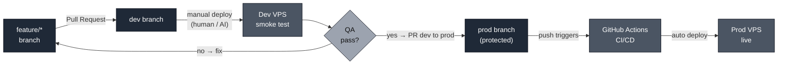
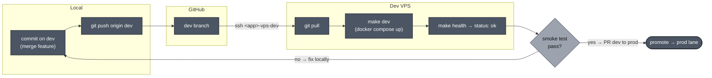
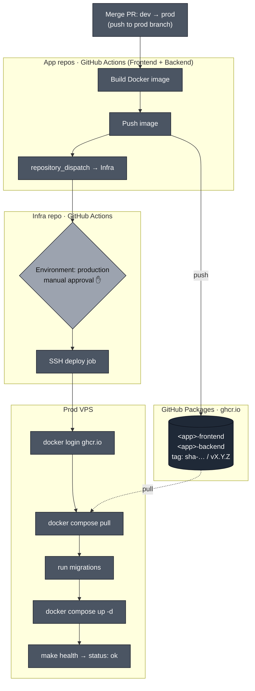

# /cicd — CI/CD Workflow (dev branch = manual, prod branch = automated)

> "Dev is deployed by hand. Prod is deployed by the pipeline — never by a human or AI directly."

Two lanes, split by branch:

- **`dev` branch** → deploy manually to **Dev VPS** exactly as in [`deploy-workflow.md`](../references/deploy-workflow.md). AI may do this.
- **`prod` branch** → deploy ONLY through **GitHub Actions CI/CD**. Images are built and pushed to **GitHub Packages (ghcr.io)**, then the Prod VPS pulls them. **AI must NOT deploy prod directly** — no `ssh prod`, no `make prod` by hand.

Applies to all repos of a project: `<frontend-repo>`, `<backend-repo>`, `<infra-repo>` (owner `<owner>`).

> **Placeholders — fill per project before use:** `<owner>` (GitHub user/org), `<app>` (short app name, lowercase), `<frontend-repo>` / `<backend-repo>` / `<infra-repo>` (repo names), `<app>-vps-dev` / `<app>-vps-prod` (SSH aliases), `/opt/<app>/<infra-repo>` (infra path on VPS). See the Adapter table in Section 9.

---

## 1. Branch Model

| Branch     | Role                         | Deploy target | Who deploys                  |
| ---------- | ---------------------------- | ------------- | ---------------------------- |
| `feature/*`| Work in progress             | none          | —                            |
| `dev`      | Integration + smoke test     | Dev VPS       | Human / AI, manual           |
| `prod`     | Production-ready             | Prod VPS      | GitHub Actions only          |

Flow:



Rules:

- Never push directly to `prod`. Only merge via PR from `dev`.
- `prod` is protected: required PR review + status checks + GitHub Environment approval.
- A merge into `prod` is the single approval gate. After that, the pipeline owns the deploy.

---

## 2. Dev Lane — Manual (unchanged)

Follow [`deploy-workflow.md`](../references/deploy-workflow.md).



Commands:

```bash
git switch dev
git pull
# merge feature work into dev, then:
git push origin dev

ssh <app>-vps-dev
cd /opt/<app>/<infra-repo>
git pull
make dev        # docker compose up (builds locally OR pulls :dev image)
make health     # smoke test -> {"status":"ok"}
```

rc tags (`vX.Y.Z-rc.N`) may still be used on `dev` for smoke testing. Dev uses seed/fake data only.

---

## 3. Prod Lane — CI/CD via GitHub Actions + GitHub Packages



Trigger: push to `prod` branch (and version tags `v*`). No manual SSH from local/AI.

---

## 4. GitHub Packages (ghcr.io)

Container images live in GitHub Packages. Image names are lowercase:

| Source repo        | Image                                       |
| ------------------ | ------------------------------------------- |
| `<frontend-repo>`  | `ghcr.io/<owner>/<app>-frontend`            |
| `<backend-repo>`   | `ghcr.io/<owner>/<app>-backend`             |

Tags pushed per build: `prod` (branch), `sha-<short>`, and `vX.Y.Z` (on version tags). The Prod VPS pulls by immutable `sha-...` or `vX.Y.Z`, never `latest`.

**App repos** (Frontend, Backend) only **build + push** images.
**Infra repo** holds `docker-compose.prod.yml` (referencing the ghcr images) and **runs the deploy**.

---

## 5. Workflow files

### 5a. App repo — build & push image
`.github/workflows/prod-image.yml` in **Frontend** and **Backend** (set `IMAGE` per repo):

```yaml
name: Prod image
on:
  push:
    branches: [prod]
    tags: ['v*']

permissions:
  contents: read
  packages: write

env:
  IMAGE: ghcr.io/<owner>/<app>-backend   # frontend: ...-frontend

jobs:
  build-push:
    runs-on: ubuntu-latest
    steps:
      - uses: actions/checkout@v4
      - uses: docker/setup-buildx-action@v3
      - uses: docker/login-action@v3
        with:
          registry: ghcr.io
          username: ${{ github.actor }}
          password: ${{ secrets.GITHUB_TOKEN }}   # built-in, no PAT needed to push
      - id: meta
        uses: docker/metadata-action@v5
        with:
          images: ${{ env.IMAGE }}
          tags: |
            type=ref,event=branch
            type=semver,pattern=v{{version}}
            type=sha,prefix=sha-,format=short
      - uses: docker/build-push-action@v6
        with:
          context: .
          push: true
          tags: ${{ steps.meta.outputs.tags }}
          labels: ${{ steps.meta.outputs.labels }}
      - name: Notify Infra to deploy
        run: |
          curl -fsSL -X POST \
            -H "Authorization: Bearer ${{ secrets.INFRA_DISPATCH_TOKEN }}" \
            -H "Accept: application/vnd.github+json" \
            https://api.github.com/repos/<owner>/<infra-repo>/dispatches \
            -d '{"event_type":"deploy-prod","client_payload":{"image":"${{ env.IMAGE }}","sha":"${{ github.sha }}"}}'
```

### 5b. Infra repo — deploy to Prod VPS
`.github/workflows/prod-deploy.yml` in **Infra**:

```yaml
name: Prod deploy
on:
  repository_dispatch:
    types: [deploy-prod]
  workflow_dispatch:        # allow manual re-run from GitHub UI

jobs:
  deploy:
    runs-on: ubuntu-latest
    environment: production   # protection rule -> requires manual approval
    steps:
      - name: Deploy over SSH
        uses: appleboy/ssh-action@v1
        with:
          host: ${{ secrets.PROD_SSH_HOST }}
          username: ${{ secrets.PROD_SSH_USER }}
          key: ${{ secrets.PROD_SSH_KEY }}
          script: |
            set -e
            cd /opt/<app>/<infra-repo>
            git pull --tags
            echo "${{ secrets.GHCR_READ_TOKEN }}" | docker login ghcr.io -u <owner> --password-stdin
            make prod        # docker compose pull + migrate + up -d
            make health      # {"status":"ok"} or the job fails
```

`make prod` = `docker compose -f docker-compose.prod.yml pull` → run migrations → `up -d`.

---

## 6. Required GitHub secrets / setup

**Infra repo** → Settings → Secrets and variables → Actions:

| Secret             | Value                                                        |
| ------------------ | ----------------------------------------------------------- |
| `PROD_SSH_HOST`    | Prod VPS IP (ask owner)                                     |
| `PROD_SSH_USER`    | prod deploy user (e.g. `root` or a dedicated deploy user)  |
| `PROD_SSH_KEY`     | private SSH deploy key (public half in VPS authorized_keys) |
| `GHCR_READ_TOKEN`  | PAT with `read:packages` (VPS pulls private images)         |

**Both app repos**: no extra secret to push images (built-in `GITHUB_TOKEN` + `packages: write`).
`INFRA_DISPATCH_TOKEN`: fine-grained PAT with `Contents: write` on the Infra repo (to fire `repository_dispatch`). Store in each app repo.

**Prod VPS one-time** (optional, so pulls work outside Actions too):

```bash
echo "<read:packages PAT>" | docker login ghcr.io -u <owner> --password-stdin
```

**Branch protection on `prod`** (each repo): require PR, require status checks, no direct pushes.
**Environment `production`** (Infra): add required reviewers → manual approval before every prod deploy.

---

## 7. Hard Rules for AI

- DO deploy `dev` manually (Dev VPS) per [`deploy-workflow.md`](../references/deploy-workflow.md).
- DO NOT run `ssh <app>-vps-prod`, `make prod`, or any direct Prod deploy command.
- Prod ships only by: merge PR `dev` → `prod` → pipeline → approve `production` environment in GitHub.
- Reference images by immutable tag (`sha-...` / `vX.Y.Z`), never `latest`, in `docker-compose.prod.yml`.
- Git identity: commit as the repo owner. Do not add a `Co-Authored-By: Claude` trailer unless the project explicitly allows it.

---

## 8. Checklist

- [ ] `dev` and `prod` branches exist in Frontend, Backend, Infra
- [ ] `prod` branch protected; direct push blocked
- [ ] `production` environment has required reviewers
- [ ] App repos have `prod-image.yml`; build + push to ghcr.io works
- [ ] Infra repo has `prod-deploy.yml`; secrets set
- [ ] `docker-compose.prod.yml` references `ghcr.io/...` images by immutable tag
- [ ] Prod VPS can `docker login ghcr.io` and pull
- [ ] End-to-end: merge to `prod` → image built → approve → deploy → `make health` green

---

## 9. Adapter — what to change per project

| Placeholder | Meaning | Example |
|---|---|---|
| `<owner>` | GitHub user/org owning the repos | `acme` |
| `<app>` | Short app name (lowercase, no space) | `taskflow` |
| `<frontend-repo>` / `<backend-repo>` / `<infra-repo>` | Repo names | `TaskFlow-Frontend` / `-Backend` / `-Infra` |
| `<app>-vps-dev` / `<app>-vps-prod` | SSH aliases in `~/.ssh/config` | `taskflow-vps-dev` |
| `/opt/<app>/<infra-repo>` | Infra path on the VPS | `/opt/taskflow/TaskFlow-Infra` |
| `ghcr.io/<owner>/<app>-frontend` \| `-backend` | Image names (lowercase) | `ghcr.io/acme/taskflow-backend` |
| `PROD_SSH_HOST` secret | Prod VPS IP | ask owner |

**Không cần đổi** (generic — giữ nguyên): branch model (`feature/*` → `dev` → `prod`), 2-lane split (dev manual / prod automated-only), workflow YAML structure, secret names, immutable-tag rule, `repository_dispatch` chain, the Hard Rules for AI.
