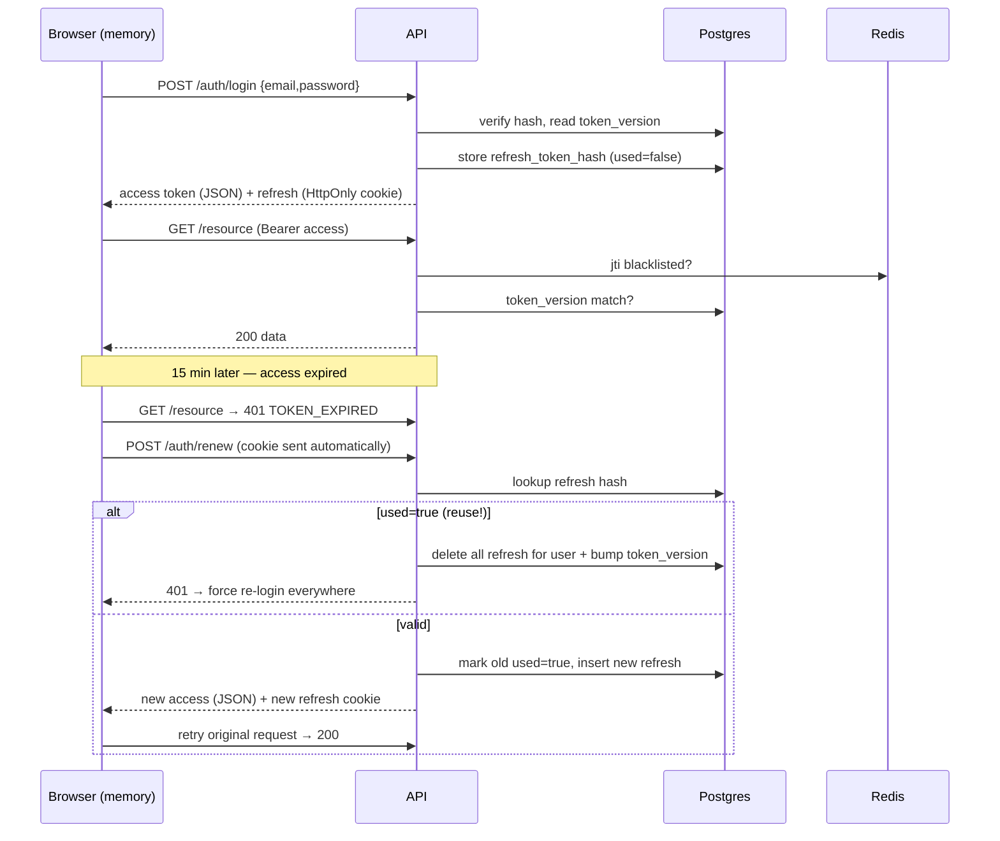

# Auth Flow — JWT + Refresh Token + Redis Blacklist

> Production-grade authentication reference. Aligned with OWASP ASVS v4 (V2 Auth, V3 Session).
> Stack-neutral (code shown in Go/Gin + React, adapt per stack). Access token = short-lived JWT
> in memory; refresh token = long-lived **opaque** random value in an HttpOnly cookie, hashed at
> rest, one-time-use with rotation + reuse detection.

---

## 0. Model at a glance

```
Access token   = JWT (HS256/RS256), 15 min, kept in JS memory only (never localStorage)
Refresh token  = 256-bit random opaque string, 7-30 days, HttpOnly+Secure cookie,
                 stored HASHED in DB, single-use, rotated on every renew
Revocation     = JTI blacklist in Redis (logout) + token_version bump (logout-all / pwd change)
```

**Why this split:** a stolen access token dies in ≤15 min and can't be silently refreshed
(refresh lives in an HttpOnly cookie JS can't read). A stolen refresh token is caught by reuse
detection (single-use rotation). Compromise of either is contained.

### Sequence — login → call → expiry → renew



---

## 1. Design decisions (fix these before coding)

### 1.1 Cookie attributes

The refresh cookie is the single most common thing that "works on localhost but breaks once
deployed". Get these exactly right: a wrong attribute makes the browser **silently drop** the
`Set-Cookie` (no error, the cookie simply never exists), and then every later `/renew` arrives with
no cookie and returns 401. See **§7-B** for the deploy-time failure playbook.

| Attribute | Value | Note |
|---|---|---|
| `HttpOnly` | **always true** | JS must never read the refresh token |
| `Secure` | **true in every real deployment** | Required by HTTPS, by `SameSite=None`, and by the `__Host-`/`__Secure-` prefixes. **A `Secure` cookie is rejected over plain HTTP on an IP or domain** — only `localhost` / `127.0.0.1` are exempt (browsers treat them as secure contexts). A staging box at `http://<ip>` therefore cannot use `Secure` → drop it *and* the name prefix for that env only (§7-B #1). |
| `SameSite` | `Lax`/`Strict` if the SPA and API are the **same site**; `None` (with `Secure`) if **cross-site** | "Site" = registrable domain (eTLD+1). `app.example.com` ↔ `api.example.com` are same-site. `myapp.com` (FE) ↔ `api.vendor.com` (API), or any two different registrable domains / IPs, are cross-site → the browser will **not** attach a `Lax`/`Strict` cookie to the cross-site `/renew` XHR → must be `SameSite=None; Secure` (§7-B #3). |
| `Path` | must match both the prefix (next row) **and** the real renew URL | The cookie is only sent to requests under this path. If `Path=/api/auth` but the client calls `/auth/renew` (or `/api/v1/auth/renew`), the cookie is **not** attached (§7-B #5). |
| Name prefix | `__Host-` **only with `Path=/`, `Secure`, no `Domain`**; else `__Secure-` | ⚠️ `__Host-` **requires `Path=/`** — `__Host-rt; Path=/api/auth` is **invalid and silently dropped**. To keep a scoped `Path=/api/auth`, use **`__Secure-rt`** (it only requires `Secure`). On plain-HTTP IP, drop the prefix entirely (prefixes force `Secure`). |
| `Domain` | **omit** (host-only) unless you truly need cross-subdomain | `__Host-` forbids `Domain`. `Domain=.example.com` widens the blast radius across subdomains. |
| `Max-Age` | refresh TTL (e.g. 604800) | matches DB `expires_at` |

**Recommended default (same-site HTTPS):** `__Secure-rt=<raw>; HttpOnly; Secure; SameSite=Lax; Path=/api/auth; Max-Age=604800`.
Use `__Host-` (stricter, browser-enforced no-Domain) only if you set `Path=/` and scope in the app.

> **Decide the cookie policy by environment, not once.** `Secure`, the name prefix, and `SameSite`
> all depend on (a) is the connection HTTPS? (b) are FE and API the same site? Build a small helper
> that emits the right attributes per env — see §5.11 and §7-B. Cross-site (`SameSite=None`) makes
> CSRF protection (§12) mandatory, not optional.

### 1.2 JWT claims (access token) — use registered claims, not ad-hoc keys

```json
{
  "iss": "https://api.example.com",   // issuer — validate on every request
  "aud": "example-web",               // audience — validate
  "sub": "<user_id>",                 // subject
  "iat": 1730000000,                  // issued-at
  "nbf": 1730000000,                  // not-before
  "exp": 1730000900,                  // 15 min
  "jti": "<uuid-v4>",                 // unique id — blacklist target
  "tv":  3,                           // token_version snapshot
  "roles": ["user"]                   // optional, for coarse authz (keep small)
}
```

- **Algorithm:** `HS256` (single service, shared secret) or `RS256`/`ES256` (multiple verifiers /
  public-key verification). Pin the algorithm server-side — **reject `alg:none` and reject a token
  whose `alg` differs from the expected one** (classic JWT bypass).
- **Key rotation:** put a `kid` in the JWT header; keep a small map of `kid → key`; sign with the
  newest, still verify with the previous until all old tokens expire.
- **Clock skew:** allow ±60s leeway on `exp`/`nbf` validation across machines.
- Never put secrets/PII (password hash, full email if avoidable) in the payload — it's only
  base64, not encrypted.

### 1.3 Password hashing

- **Argon2id** (preferred) or **bcrypt cost ≥ 12** / **scrypt**. Never MD5/SHA-1/plain SHA-256.
- Store only the encoded hash (`$argon2id$...`) — algorithm + params + salt are embedded.
- On a parameter upgrade, re-hash transparently on next successful login.

### 1.4 Refresh token

- **Opaque** random ≥ 32 bytes (`crypto/rand`), base64url — NOT a JWT (so it can be revoked by
  deletion, and reveals nothing if leaked in a log).
- Store **only the hash** (sha256 is fine for a high-entropy random token; bcrypt is overkill and
  slow here). Compare in constant time.
- **Single-use + rotation:** each renew consumes the old one and issues a new one. Reuse of an
  already-consumed token ⇒ theft ⇒ revoke the whole family (§5).

---

## 2. Database schema

```sql
-- users: auth-relevant columns
ALTER TABLE users
  ADD COLUMN password_hash     TEXT       NOT NULL,
  ADD COLUMN email_verified    BOOLEAN    NOT NULL DEFAULT false,
  ADD COLUMN token_version     INTEGER    NOT NULL DEFAULT 0,   -- bump = revoke all access tokens
  ADD COLUMN failed_logins     INTEGER    NOT NULL DEFAULT 0,
  ADD COLUMN locked_until      TIMESTAMPTZ,                     -- brute-force lockout
  ADD COLUMN totp_secret       TEXT,                            -- NULL = 2FA off (encrypt at rest)
  ADD COLUMN totp_enabled      BOOLEAN    NOT NULL DEFAULT false,
  ADD COLUMN last_login_at     TIMESTAMPTZ;

-- refresh tokens (one row per issued refresh; rotation = insert new + mark old used)
CREATE TABLE refresh_tokens (
    id          UUID PRIMARY KEY DEFAULT gen_random_uuid(),
    user_id     UUID NOT NULL REFERENCES users(id) ON DELETE CASCADE,
    token_hash  TEXT NOT NULL,                     -- sha256(refresh)
    family_id   UUID NOT NULL,                     -- rotation family — reuse revokes the whole family
    jti         UUID NOT NULL,                     -- links to the access token issued alongside
    user_agent  TEXT,                              -- for "active sessions" UI
    ip          INET,
    expires_at  TIMESTAMPTZ NOT NULL,
    used        BOOLEAN NOT NULL DEFAULT false,     -- true after it's been rotated/consumed
    created_at  TIMESTAMPTZ NOT NULL DEFAULT NOW()
);
CREATE INDEX idx_refresh_user   ON refresh_tokens(user_id);
CREATE INDEX idx_refresh_hash   ON refresh_tokens(token_hash);
CREATE INDEX idx_refresh_family ON refresh_tokens(family_id);

-- email verification + password reset (single-use, short-lived, store HASH not raw)
CREATE TABLE auth_tokens (
    id          UUID PRIMARY KEY DEFAULT gen_random_uuid(),
    user_id     UUID NOT NULL REFERENCES users(id) ON DELETE CASCADE,
    kind        TEXT NOT NULL CHECK (kind IN ('email_verify','password_reset')),
    token_hash  TEXT NOT NULL,
    expires_at  TIMESTAMPTZ NOT NULL,              -- verify: 24h, reset: 15-60 min
    used_at     TIMESTAMPTZ,
    created_at  TIMESTAMPTZ NOT NULL DEFAULT NOW()
);
CREATE INDEX idx_auth_tokens_hash ON auth_tokens(token_hash);
```

---

## 3. Prerequisites (one-time setup)

| # | Task |
|---|---|
| 1 | `JWT_SECRET` (or RSA/EC keypair) in `.env` — never commit; rotate via `kid` |
| 2 | Redis for the JTI blacklist + login rate-limit counters |
| 3 | `users` columns + `refresh_tokens` + `auth_tokens` tables (see §2) |
| 4 | SMTP/email provider for verification + password-reset mail |
| 5 | Frontend: React Context / Zustand store holding the access token **in memory only** |
| 6 | Frontend: dedicated axios instance with a 401 → renew interceptor (+ single-flight lock) |
| 7 | Security headers: HSTS, CSP (`default-src 'self'`), `X-Content-Type-Options: nosniff`, `Referrer-Policy` |

---

## 4. Registration + Email Verification

### 4.1 Register — `POST /api/auth/register`

1. Validate input: email format, password policy (length ≥ 8-12, check against a breached-password
   list if possible — don't over-enforce composition rules).
2. **Anti-enumeration:** if the email already exists, still return the **same** generic success
   response and (optionally) send a "you already have an account" email — do NOT reveal existence.
3. Hash the password (Argon2id/bcrypt). Insert user with `email_verified=false`.
4. Create an `auth_tokens` row (`kind='email_verify'`, hash of a random token, `expires_at=+24h`).
5. Email a link `https://app/verify?token=<raw>`.
6. Return generic success. **Do not** auto-login before verification (policy choice — some apps
   allow limited access; state it explicitly).

### 4.2 Verify — `GET /api/auth/verify?token=...`

1. Hash the incoming token, look up `auth_tokens` where `kind='email_verify'`, not used, not expired.
2. Not found/expired → generic error page + "resend verification" option.
3. Valid → set `users.email_verified=true`, set `used_at=NOW()`.
4. Redirect to login (or auto-login by issuing tokens per §5, owner's choice).

> Resend verification must be **rate-limited** (e.g. 1/min, 5/hour per account) to prevent mail flooding.

---

## 5. Login

### `POST /api/auth/login` — hardened flow

1. Read `{ email, password }`.
2. **Rate limit first** (before touching the DB): key `login_attempts:<ip>` and
   `login_attempts:<email>` in Redis. Over threshold → `429` with `Retry-After`. Combine with
   per-device lockout from [[device-fingerprint]] (`attempts:login:<visitorId>`) so IP rotation
   doesn't bypass it.
   - **Per-endpoint defaults** — the sensitive auth routes get a much tighter limit than generic
     API traffic. Sensible starting point (tune per app): `sign-in` / `sign-up` / `forgot-password`
     / `reset-password` / `change-password` / `change-email` → **3–5 requests / 10s per IP+identifier**;
     `mfa/verify` → 5 / 60s. Everything else keeps the normal API limit. Store counters in Redis so
     the limit survives a process restart (in-memory counters reset and are unusable on serverless /
     multi-replica).
3. Look up the user by email.
4. **Timing-safe + enumeration-safe:** if the user doesn't exist, still run a **dummy** hash
   compare against a constant fake hash, then return the **same** generic `401 INVALID_CREDENTIALS`
   as a wrong password. Never distinguish "no such email" from "wrong password".
5. If `locked_until > now` → `423 LOCKED_OUT` + `retry_after`.
6. Compare password (constant-time / library `CompareHashAndPassword`).
   - Wrong → `failed_logins++`; if it crosses the threshold (e.g. 5), set `locked_until = now + 15m`
     (exponential backoff on repeat). Return `401 INVALID_CREDENTIALS`.
7. If `email_verified=false` and policy requires it → `403 EMAIL_NOT_VERIFIED`.
8. **If `totp_enabled`** → do NOT issue tokens yet; return `200 { mfa_required: true, mfa_token }`
   where `mfa_token` is a short-lived (5 min) one-time challenge token. Client then calls
   `/auth/mfa/verify` (§9).
9. Success path: reset `failed_logins=0`, clear `locked_until`, set `last_login_at`.
10. Read `token_version`. Issue:
    - **Access token** (JWT, §1.2, 15 min).
    - **Refresh token**: random opaque; store `sha256(refresh)` with a new `family_id`,
      `jti = access.jti`, `user_agent`, `ip`, `expires_at=+7d`, `used=false`.
11. Response:
    - Access token → **JSON body**.
    - Refresh token → `Set-Cookie`, attributes chosen **by environment** (§1.1 + §7-B). Pick ONE consistent scheme and keep the path/prefix valid:
      - Same-site HTTPS (default): `__Secure-rt=<raw>; HttpOnly; Secure; SameSite=Lax; Path=/api/auth; Max-Age=604800`
      - Cross-site FE/API, HTTPS: `__Secure-rt=<raw>; HttpOnly; Secure; SameSite=None; Path=/api/auth; Max-Age=604800`  (+ CORS credentials, §7-B #3)
      - Plain-HTTP IP (dev/staging only): `rt=<raw>; HttpOnly; SameSite=Lax; Path=/api/auth; Max-Age=604800`  (no `Secure`, no prefix — both dropped over HTTP; never ship to Prod)
      - `__Host-` variant (strictest) requires `Path=/`: `__Host-rt=<raw>; HttpOnly; Secure; SameSite=Lax; Path=/; Max-Age=604800`.
      Emit these from one helper, e.g. Go/Gin: `c.SetSameSite(ss); c.SetCookie(name, raw, maxAge, "/api/auth", "", secure, true)` where `name`/`ss`/`secure` come from env.
12. Frontend stores the access token in memory and redirects.

---

## 6. Normal API Calls

1. Axios interceptor attaches `Authorization: Bearer <access>`.
2. Server: verify signature with `JWT_SECRET`/public key; **validate `iss`, `aud`, `exp`, `nbf`,
   and the `alg`**. Reject `alg:none` and unexpected algorithms.
3. Extract `sub`, `tv`, `jti`.
4. Check Redis blacklist `revoked_jti:<jti>` → if present, `401`.
5. Compare `tv` against the user's current `token_version` (cache it; e.g. 60s TTL) → mismatch → `401`.
6. Pass → handle request. (Fine-grained authorization = RBAC, see [[RBAC]].)

> Steps 4-5 are the revocation layer that a stateless JWT normally lacks.

---

## 7. Access Token Expired → Renew (with rotation race handling)

1. Access verify finds `exp` in the past → `401 TOKEN_EXPIRED`.
2. Axios interceptor catches it. **Single-flight:** if a `/renew` is already in flight, queue this
   request and reuse its result (prevents a stampede where 10 parallel 401s fire 10 renews).
3. `POST /api/auth/renew` — cookie carries the refresh token automatically.
4. Server hashes the cookie value, looks it up in `refresh_tokens`.
   - Not found / expired → `401`, clear cookie.
   - **`used = true` (reuse of a rotated token = theft):**
     - Revoke the **entire family** (`DELETE ... WHERE family_id = <family>`), OR to be safe delete
       all refresh tokens for the user, and **bump `token_version`** (kills every live access token).
     - `401` → every device forced to re-login. Optionally alert the user ("suspicious activity").
   - Valid, `used=false`:
     - **Atomically** mark old `used=true` (`UPDATE ... WHERE id=? AND used=false` and check rows
       affected = 1 — this makes concurrent double-renew safe: the loser gets 0 rows and retries
       with the new token instead of triggering false reuse detection).
     - Issue a new access token + new refresh token in the **same `family_id`**.
     - Return access token in JSON + new refresh cookie (replaces old).
5. Frontend updates in-memory access token; interceptor retries the original request. User sees nothing.

> **Race note:** a real double-tab renew must NOT be treated as theft. That's why rotation uses the
> conditional `UPDATE ... WHERE used=false` guard + a short grace window, not a naive "was it used".

---

## 7-B. Renew works on localhost but 401s on an IP / Prod (deployment cookie failures)

> **Symptom (very common):** login + refresh work perfectly on `localhost`. Deploy to a bare IP
> (`http://203.0.113.10`) or to Prod and `/auth/renew` suddenly returns 401 — the client cannot
> mint a new access token because **the refresh cookie is missing on the renew request**. The user
> is bounced to `/login` the moment the 15-minute access token expires.

**Root mechanism.** Almost always the cookie is *never stored* or *never sent* — not a crypto/DB
bug. A `Set-Cookie` carrying an attribute the browser refuses is **silently dropped** (no console
error). Every later `/renew` then arrives with no `Cookie:` header, the server finds no refresh
token, and returns 401. **Why localhost hides it:** the dev server (Vite/CRA proxy) makes the FE
and API the *same origin*, and `localhost`/`127.0.0.1` are treated as *secure contexts* — so
`Secure`, `SameSite`, the `__Host-`/`__Secure-` prefixes, and CORS-credentials all "just work"
without configuration. Deploying removes all three cushions at once.

### 5-minute diagnosis (DevTools) — do this first
1. **Network → the `login` response → `Set-Cookie`.** Present? Chrome strikes it through / shows a
   ⚠ if it *rejected* the cookie (hover for the reason: "Secure", "SameSite=None requires Secure",
   "This attempt to set a cookie via a `__Host-` prefix...").
2. **Application → Cookies → the API origin.** Is the refresh cookie actually stored?
   - Set-Cookie present but cookie **not stored** → an **attribute was rejected** → cause #1/#2/#3.
3. **Network → the `renew` request → Request Headers → `Cookie:`.** Present?
   - Cookie stored but **not sent** on renew → **Path / SameSite / Domain / withCredentials** → cause #3/#5.

### The five root causes and their fixes

**#1 — Plain HTTP on an IP → `Secure` cookie dropped.** `Secure` (and the prefixes, and
`SameSite=None`) all require HTTPS; only `localhost`/`127.0.0.1` are exempt. Over `http://<ip>` the
browser refuses the cookie.
- **Fix (correct):** serve HTTPS even in staging — Caddy auto-cert, a self-signed cert, or a
  Cloudflare Tunnel in front of the IP; keep `Secure` + prefix.
- **Fix (throwaway staging only):** gate the cookie policy on env — drop `Secure` **and** the name
  prefix when serving plain HTTP. Never on Prod.

**#2 — `__Host-` prefix with a non-root `Path` → cookie dropped.** `__Host-` **requires** `Secure`,
**no `Domain`, and `Path=/`**. `__Host-rt; Path=/api/auth` is invalid → silently dropped.
- **Fix:** for a scoped `Path=/api/auth`, use **`__Secure-rt`** (only requires `Secure`). Use
  `__Host-` only with `Path=/`.

**#3 — Cross-origin FE/API without `SameSite=None` + CORS credentials.** The #1 Prod cause. "Same
site" = same registrable domain: `app.example.com` ↔ `api.example.com` are same-site (Lax works);
two different domains/IPs are **cross-site** → a `Strict`/`Lax` cookie is **not attached** to the
cross-site `/renew` XHR. A credentialed cross-origin XHR also needs CORS to explicitly allow
credentials.
- **Cookie:** `SameSite=None; Secure` (None without Secure is rejected).
- **Frontend:** the axios instance **and** the renew call must send credentials:
  ```js
  const api = axios.create({ baseURL: import.meta.env.VITE_API_URL, withCredentials: true })
  // renew (and the silent-renew useEffect) must also pass it:
  axios.post(`${baseURL}/auth/renew`, {}, { withCredentials: true })   // fetch → credentials: 'include'
  ```
- **Backend CORS (Gin):** allow credentials + an **exact** origin (never `*` — the browser blocks
  `*` together with credentials) and answer the preflight `OPTIONS`:
  ```go
  r.Use(cors.New(cors.Config{
      AllowOrigins:     []string{"https://app.example.com"}, // exact FE origin(s), not "*"
      AllowMethods:     []string{"GET","POST","PATCH","DELETE","OPTIONS"},
      AllowHeaders:     []string{"Authorization","Content-Type","X-Visitor-ID"},
      AllowCredentials: true,                                  // → Access-Control-Allow-Credentials: true
      MaxAge:           12 * time.Hour,
  }))
  ```

**#4 — Reverse proxy / CDN terminates TLS → the app thinks it's on HTTP.** Behind nginx or
Cloudflare, browser↔edge is HTTPS but edge↔app is HTTP, so Go's `r.TLS == nil`. Deciding `Secure`
from `r.TLS` then wrongly emits a non-Secure cookie. Cloudflare "Flexible" SSL makes the origin
genuinely HTTP.
- **Fix:** decide `Secure` from config (`APP_ENV=production ⇒ Secure=true`) or trust
  `X-Forwarded-Proto`. Make the proxy forward it, and use Cloudflare SSL mode **Full (Strict)**:
  ```nginx
  location /api/ {
      proxy_pass         http://api:8080;
      proxy_set_header   Host              $host;
      proxy_set_header   X-Forwarded-For   $proxy_add_x_forwarded_for;
      proxy_set_header   X-Forwarded-Proto $scheme;   # ← app now knows the client used HTTPS
  }
  ```

**#5 — Cookie `Path` doesn't match the real renew URL.** The cookie is only sent to requests whose
path is under its `Path`. Classic env-specific break: cookie `Path=/api/auth`, but the FE posts to
`${baseURL}/auth/renew` where `baseURL` is the bare API origin (`https://api.example.com`) — so the
request path is `/auth/renew`, **not** `/api/auth/renew`, and the cookie is not attached. On
localhost it worked because `baseURL` was the proxy prefix `/api`, yielding `/api/auth/renew`.
- **Fix:** make the cookie `Path` a strict prefix of the renew route **in every environment**;
  align the FE base URL + route so the renew path always starts with the cookie `Path` (or simplest,
  `Path=/` and scope in the app).

### Environment cheat-sheet

| Environment | Same-site? | Cookie attributes | CORS |
|---|---|---|---|
| `localhost` + dev proxy | yes (same origin) | `Secure` optional (localhost exempt), `SameSite=Lax`, prefix optional | not needed |
| Bare IP over **HTTP** (staging) | usually same origin | **no** `Secure`, **no** prefix, `SameSite=Lax` | only if FE≠API origin |
| Prod, FE+API **same site** (HTTPS) | yes | `__Secure-rt; Secure; SameSite=Lax; Path=/api/auth` | credentials + exact origin if different subdomain/origin |
| Prod, FE+API **cross-site** (HTTPS) | no | `__Secure-rt; Secure; SameSite=None; Path=/api/auth` | **required**: credentials + exact origin |

> **Rule of thumb:** the moment the browser's address-bar host differs from the API host you are
> cross-origin (need CORS + `withCredentials`); if the *registrable domain* differs you are also
> cross-site (need `SameSite=None`). Prefer putting FE and API behind **one origin** (reverse-proxy
> the API under `/api` on the same host) — it sidesteps causes #3 and #5 entirely and is exactly why
> the whole thing "just works" on localhost.

---

## 8. Forgot / Reset / Change Password

### 8.1 Forgot — `POST /api/auth/forgot-password { email }`

1. **Always** return the same generic `200 "If that email exists, a reset link was sent."` —
   never reveal whether the email exists.
2. If the user exists: create `auth_tokens` (`kind='password_reset'`, hashed random, `expires_at=+15..60m`),
   email `https://app/reset?token=<raw>`. Rate-limit (1/min, 3/hour per email + per IP).

### 8.2 Reset — `POST /api/auth/reset-password { token, new_password }`

1. Hash token, look up unused/unexpired `password_reset` row → else `400 INVALID_TOKEN`.
2. Validate new password policy. Hash + update `users.password_hash`.
3. Mark token `used_at=NOW()`.
4. **Invalidate every session:** bump `token_version` + delete all `refresh_tokens` for the user.
5. Optionally email "your password was changed" notice. Redirect to login.

### 8.3 Change password (logged-in) — `POST /api/auth/change-password { current, new }`

1. Verify `current` against the stored hash → else `401`.
2. Update hash. Bump `token_version` + delete all refresh tokens **except the current session**
   (or all of them — owner's choice; "sign out other devices" is the safer default).

### 8.4 Fresh-session gate for sensitive actions (`fresh_age`)

Some actions are dangerous even with a valid access token: change password, change email, disable
MFA, delete account, view/rotate API keys, add a new OAuth link. Require the session to have
authenticated **recently** (a *fresh* session), not just to be logged in.

- Track when the session last proved the password/MFA: put `auth_time` (unix seconds) in the access
  token claims, or store `last_auth_at` on the refresh-token/session row.
- On a sensitive endpoint, require `now - auth_time <= fresh_age` (e.g. **5–15 min**). If stale →
  `401 REAUTH_REQUIRED`; the client prompts for the password (or MFA) and retries.
- A silent `/renew` (rotation) does **not** refresh `auth_time` — only a real credential check does.
  This is what stops a stolen-but-still-valid session from silently changing the password.

---

## 9. Two-Factor Auth (TOTP) — optional

### 9.1 Enroll — `POST /auth/mfa/setup` (authenticated)

1. Generate a TOTP secret; store **encrypted** in `users.totp_secret` (not `totp_enabled` yet).
2. Return an `otpauth://` URI → client renders a QR.
3. `POST /auth/mfa/enable { code }` — verify one TOTP code, set `totp_enabled=true`, and issue a
   set of one-time **recovery codes** (store hashed).

### 9.2 Login second factor — `POST /auth/mfa/verify { mfa_token, code }`

1. Validate the short-lived `mfa_token` from login step 8.
2. Verify TOTP `code` (±1 time-step window) or a recovery code (mark it consumed).
3. On success, issue access + refresh exactly as login step 10-11.
4. Rate-limit MFA attempts (lock after N fails).

---

## 10. OAuth2 / Social Login — optional

`GET /auth/oauth/:provider` → redirect to provider with `state` (CSRF nonce, stored in Redis 10 min,
single-use) + PKCE.
`GET /auth/oauth/:provider/callback?code&state`:
1. Validate `state` (one-time). Exchange `code` → provider tokens (server-side, PKCE verifier).
2. Fetch the provider profile (email + provider id).
3. Link: find user by `(provider, provider_id)`; else by verified email (link accounts carefully —
   only auto-link if the provider asserts the email is verified); else create a user.
4. Issue your own access + refresh (§5.10-11). **Never** hand the provider's token to the browser.

> Social login usually needs `SameSite=Lax` (the callback is a top-level cross-site GET). See §1.1.

**Encrypt stored provider tokens at rest.** If you persist the provider's `access_token` /
`refresh_token` to call its API later on the user's behalf, store them **encrypted** (AES-256-GCM
with a key from env/KMS), not plaintext — a DB dump otherwise leaks live third-party credentials.
If you don't need to call the provider after login, **don't store its tokens at all** (only the
`provider_id` link). Keep the OAuth `state` single-use with a short TTL (§10) and use PKCE on every
flow.

---

## 11. Logout & Session Management

### 11.1 Logout (this device) — `POST /api/auth/logout`

1. From the access token, take `jti` + `exp`; add `revoked_jti:<jti>` to Redis with `TTL = exp-now`.
2. Read the refresh cookie → delete that `refresh_tokens` row (or its family).
3. `Set-Cookie: __Host-rt=; Max-Age=0`. Frontend clears memory → `/login`.

### 11.2 Logout all / global sign-out — `POST /api/auth/logout-all`

1. Bump `users.token_version` (every live access token now fails §6 step 5).
2. Delete all `refresh_tokens` for the user.
3. Clear the current cookie.

### 11.3 List / revoke sessions — `GET /auth/sessions`, `DELETE /auth/sessions/:id`

- List rows from `refresh_tokens` (user_agent, ip, created_at, current?) for a "your devices" UI.
- Revoke one → delete that family; the corresponding device is logged out on its next renew.

### 11.4 Auth audit log (security events)

Record the security-relevant auth events to an append-only `auth_audit` table (separate from
business logs) — you need them for incident response and abuse detection, and they must survive even
when the request itself fails. Log **fire-and-forget** (never block or fail the auth flow on an audit
write). Minimum events + fields:

| Event | Fields |
|---|---|
| `login.success` / `login.failed` | user_id (if known), ip, user_agent, reason |
| `refresh.reuse_detected` | user_id, family_id, ip |
| `password.changed` / `password.reset` | user_id, ip |
| `email.changed` | user_id, old_email_hash, new_email_hash |
| `mfa.enabled` / `mfa.disabled` / `mfa.failed` | user_id, ip |
| `session.created` / `session.revoked` / `logout_all` | user_id, session/family id, ip, user_agent |
| `oauth.linked` / `oauth.unlinked` | user_id, provider |

Never log raw tokens, passwords, or full emails — hash or redact PII (§Anti-patterns). Keep 90 days
hot, archive older per your retention policy. If you already have an RBAC audit trail ([[RBAC]]),
reuse it — but keep these auth events even for actions that don't pass an `authorize()` check.

---

## 12. CSRF Protection

Needed whenever the refresh (or any auth mutation) relies on a cookie the browser sends automatically.

- `SameSite=Strict/Lax` blocks most cross-site cookie sends — necessary but **not sufficient** alone.
- Restrict the refresh cookie to `Path=/api/auth` so only auth routes ever receive it.
- For state-changing endpoints reachable with cookies, add **double-submit CSRF token** (or the
  synchronizer pattern): a non-HttpOnly `csrf` cookie mirrored in an `X-CSRF-Token` header the
  server compares. Access-token-in-Authorization-header requests are inherently CSRF-safe (a header
  can't be forged cross-site), so only cookie-authenticated routes need this.
- Validate `Origin`/`Referer` on sensitive POSTs as defense-in-depth.

---

## 13. Standard Error Code Registry

| Code | HTTP | When |
|---|---|---|
| `INVALID_CREDENTIALS` | 401 | wrong email OR password (never distinguish) |
| `TOKEN_EXPIRED` | 401 | access token past `exp` → client triggers renew |
| `TOKEN_INVALID` | 401 | bad signature / alg / claims / blacklisted jti / token_version mismatch |
| `EMAIL_NOT_VERIFIED` | 403 | login blocked until verification (if policy) |
| `MFA_REQUIRED` | 200* | first factor OK, awaiting TOTP (`*` not an error, a step) |
| `LOCKED_OUT` | 423 | brute-force lockout → `retry_after_seconds` |
| `RATE_LIMITED` | 429 | too many attempts → `Retry-After` |
| `INVALID_TOKEN` | 400 | bad/expired email-verify or reset token |
| `REUSE_DETECTED` | 401 | rotated refresh token replayed → family revoked |
| `REAUTH_REQUIRED` | 401 | sensitive action on a stale session → client must re-authenticate (§8.4) |

Keep responses generic on the auth surface — don't leak which field failed.

---

## 14. API Endpoint Contract

| Method | Path | Auth | Body / Note |
|---|---|---|---|
| POST | `/api/auth/register` | — | `{email,password}` → generic success |
| GET  | `/api/auth/verify` | — | `?token=` → verify email |
| POST | `/api/auth/login` | — | `{email,password}` → access(JSON)+refresh(cookie) or `mfa_required` |
| POST | `/api/auth/mfa/verify` | mfa_token | `{mfa_token,code}` → tokens |
| POST | `/api/auth/renew` | refresh cookie | rotate → new access+refresh |
| POST | `/api/auth/logout` | access | blacklist jti + delete refresh |
| POST | `/api/auth/logout-all` | access | bump token_version |
| POST | `/api/auth/forgot-password` | — | `{email}` → generic success |
| POST | `/api/auth/reset-password` | — | `{token,new_password}` |
| POST | `/api/auth/change-password` | access | `{current,new}` |
| GET  | `/api/auth/sessions` | access | list devices |
| DELETE | `/api/auth/sessions/:id` | access | revoke one device |
| GET  | `/api/auth/oauth/:provider` | — | redirect to provider |
| GET  | `/api/auth/oauth/:provider/callback` | — | exchange code → tokens |

---

## Device Fingerprint — `X-Visitor-ID`

> A soft signal layer on top of JWT auth. Never replaces auth — always graceful degradation.

### Architecture

```
Frontend (FingerprintJS)
  └─ getVisitorId() → cached in module memory
        └─ every API request: X-Visitor-ID: <visitorId>

Backend (FingerprintMiddleware)
  └─ reads X-Visitor-ID header
  └─ fallback: sha256(IP + User-Agent) with prefix "fb_"
  └─ sets gin context key "visitor_id"
```

### Frontend — `src/utils/fingerprint.js`

- Library: `@fingerprintjs/fingerprintjs` (free, client-side)
- Result cached in module memory — load once per session
- Failure is **silently ignored** (`catch(() => null)`) — never blocks the app
- Attached via `axios.js` request interceptor as `X-Visitor-ID` header

### Backend — `middlewares/fingerprint.go`

```go
// Applied globally to all routes
func FingerprintMiddleware() gin.HandlerFunc

// Fallback when X-Visitor-ID header is absent
func fallbackFingerprint(c *gin.Context) string {
    // sha256(IP + User-Agent)[:8], prefixed "fb_"
}

func GetVisitorID(c *gin.Context) string  // used by controllers
```

### Redis Key Registry (device fingerprint)

| Key pattern | TTL | Purpose |
|---|---|---|
| `device_registered:<visitorID>` | 30 days | Marks device as having a registered account — used to block multi-account abuse |
| `device_usage:<visitorID>:<date>` | 25 hours | Daily resource usage per device — secondary signal for rate gates |
| `attempts:<resourceID>:<visitorID>` | Tuỳ use case | Brute-force lockout per device (thay vì chỉ per IP) |

### How it is used

| Feature | Usage |
|---|---|
| **Register** | `SetDeviceRegistered(visitorID, userID)` — marks device as registered (async goroutine) |
| **Reward tracking** | `IsDeviceRegistered(visitorID)` — if device already registered, skip reward to prevent multi-account farming |
| **Resource gate** | `GetDeviceUsage(visitorID, date)` — secondary count alongside user-level count; `IncrDeviceUsage` after action |
| **Action rate limit** | `GetAttempts(resourceID, visitorID)` — lockout after N failed attempts per device |

### Design rules

1. **visitorID is always optional** — every code path has a fallback or no-op when `visitorID == ""`
2. **Never block auth** — FingerprintJS failure → `null` → feature degrades silently, auth still works
3. **Not a security boundary** — fingerprint can be spoofed; only used for soft rate-limiting and referral anti-abuse
4. **Fallback ID** prefixed `fb_` — easy to distinguish in logs from real FingerprintJS IDs

---

## Lessons Learned

### 1. APP_ENV must be set correctly in the prod `.env`

**Incident:** The `refresh_token` cookie did not have the `Secure` flag on production.

**Root cause:** The prod `.env` file had `APP_ENV=development` (the default value that was never changed during initial setup). The code checks `global.Cfg.Server.Env == "production"` → `false` → `Secure=false`.

**Rule:** After every new VPS setup, verify immediately:
```bash
docker exec <api-container> env | grep APP_ENV
# Must be: APP_ENV=production
```

If `.env` is owned by root and the deploy user does not have permission to edit it, create an override compose file:
```yaml
# /home/deploy/docker-compose.env-override.yml
services:
  api:
    environment:
      APP_ENV: production
```

And add `-f /home/deploy/docker-compose.env-override.yml` to every `docker compose up` command.

### 2. Login + Register must have silent renew — missing either one is inconsistent

**Incident:** `/register` auto-redirects to home when a valid cookie still exists, but `/login` does not — the user has to log in manually even though the session is still valid.

**Root cause:** The Register page has silent renew in `useEffect`, the Login page does not — it was missed.

**Rule:** Every public auth page (`/login`, `/register`, and any page the user does not need to be logged in to view) **must have** the same silent renew block:

```js
useEffect(() => {
  if (token) { navigate('/home', { replace: true }); return }
  const baseURL = import.meta.env.VITE_API_URL || '/api'
  axios.post(`${baseURL}/auth/renew`, {}, { withCredentials: true })
    .then(({ data }) => {
      setAccessToken(data.data.access_token)
      navigate('/home', { replace: true })
    })
    .catch(() => setChecking(false))
}, [])
```

When adding a new public page → check immediately: *"Does this page need silent renew?"*

### 3. Renew works on localhost but 401s on IP / Prod — the refresh cookie was dropped

**Incident:** login + refresh flawless on `localhost`; on `http://<vps-ip>` and on Prod the app
logs out after 15 min because `POST /auth/renew` returns 401 — "cannot create a new accessToken
because the refreshToken can't renew".

**Root cause (usually a combination):**
- The cookie carried `Secure` and/or a `__Host-`/`__Secure-` prefix but was served over **plain
  HTTP on an IP** → browser silently dropped it (localhost is a secure context, so it never
  surfaced locally).
- `__Host-rt` was set with `Path=/api/auth` → **invalid prefix/path combo** → dropped.
- On Prod the SPA and API are on **different origins** without `SameSite=None; Secure` +
  `withCredentials` + `Access-Control-Allow-Credentials` → the cookie is never sent on `/renew`.
- Behind nginx/Cloudflare the app saw HTTP (`r.TLS==nil`) and mis-set `Secure`.

**Signal:** DevTools → login response shows `Set-Cookie` with a ⚠, or Application→Cookies has no
refresh cookie, or the `/renew` request has no `Cookie:` header.

**Fix:** full playbook in **§7-B**. Short version — serve HTTPS everywhere; use `__Secure-` (not
`__Host-`) with `Path=/api/auth`; `SameSite=None; Secure` + CORS credentials when FE≠API origin;
trust `X-Forwarded-Proto`; keep the cookie `Path` a prefix of the real renew URL in every env.

**Prevention:** after each deploy, verify in the browser: (1) refresh cookie is stored, (2) it is
attached to the `/renew` request, (3) a forced renew returns 200 with a new access token.

---

## Summary — What Is Stored Where

| Item | Stored in | TTL | Notes |
|------|-----------|-----|-------|
| Access token | React state (memory) | 15 min | never localStorage/sessionStorage |
| Refresh token (raw) | Cookie `HttpOnly+Secure+SameSite` | 7-30 days | `__Secure-` prefix + `Path=/api/auth` (or `__Host-` + `Path=/`); `SameSite=None` if cross-site — see §1.1 / §7-B |
| Refresh token hash | `refresh_tokens.token_hash` | = cookie TTL | sha256; single-use + family rotation |
| `token_version` | `users` column | persistent | bump = revoke all access tokens |
| JTI blacklist | Redis `revoked_jti:<jti>` | = token remaining life | logout revocation |
| Login rate counters | Redis `login_attempts:<ip|email>` | window (e.g. 15m) | brute-force defense |
| Email-verify / reset tokens | `auth_tokens.token_hash` | 24h / 15-60m | single-use |
| TOTP secret | `users.totp_secret` (encrypted) | persistent | 2FA |
| `JWT_SECRET` / keypair | env var / KMS | — | rotate via `kid` |

---

## Security Checklist (OWASP ASVS-aligned)

- [ ] Access token in memory only; refresh in `HttpOnly+Secure` cookie (§1.1)
- [ ] JWT: validate `iss/aud/exp/nbf`, pin `alg`, reject `alg:none` (§1.2, §6)
- [ ] Key rotation via `kid`; secret not in git (§1.2)
- [ ] Password: Argon2id/bcrypt≥12; breached-password check; no composition-only rules (§1.3)
- [ ] Refresh: opaque, hashed at rest, single-use + rotation + reuse detection (§1.4, §7)
- [ ] Login: enumeration-safe (dummy hash), timing-safe compare, generic `INVALID_CREDENTIALS` (§5)
- [ ] Brute-force: per-IP + per-email + per-device rate limit → lockout with backoff (§5)
- [ ] Renew concurrency: conditional `UPDATE ... WHERE used=false`, don't false-flag double tabs (§7)
- [ ] Cookie attributes valid for the deploy target: `Secure`+prefix only on HTTPS, `SameSite=None` (not Strict/Lax) when FE≠API site, cookie `Path` is a prefix of the renew URL, `__Host-` only with `Path=/` (§1.1, §7-B)
- [ ] Cross-origin: FE sends credentials (`withCredentials`/`credentials:'include'`); server sets `Access-Control-Allow-Credentials: true` + an exact `Allow-Origin` (never `*`) (§7-B)
- [ ] Behind a reverse proxy/CDN: app trusts `X-Forwarded-Proto` (or sets `Secure` from `APP_ENV`); Cloudflare SSL = Full (Strict), not Flexible (§7-B)
- [ ] Post-deploy smoke test: refresh cookie is stored, attached to `/renew`, and a forced renew returns a new access token (§7-B)
- [ ] Forgot/reset/verify: single-use hashed tokens, generic responses, rate-limited (§4, §8)
- [ ] Password change/reset bumps `token_version` + kills refresh tokens (§8)
- [ ] CSRF handled for any cookie-authenticated mutation (§12)
- [ ] Security headers: HSTS, CSP, `X-Content-Type-Options`, `Referrer-Policy`
- [ ] MFA/recovery codes hashed; OAuth `state`+PKCE, provider token never sent to browser (§9, §10)
- [ ] "Sign out other devices" / session list available (§11)

---

## Anti-patterns

- Storing the access token in `localStorage`/`sessionStorage` → XSS steals it. Memory only.
- Refresh token as a JWT that can't be revoked → use an opaque, DB-backed, single-use value.
- Distinguishing "no such email" from "wrong password" → account enumeration. Same response always.
- Returning early when the email doesn't exist → timing oracle. Run a dummy hash compare.
- Not rotating the refresh token on renew → a leaked refresh works forever undetected.
- Treating a double-tab concurrent renew as theft → use the `WHERE used=false` guard + grace, not naive reuse=theft.
- Accepting any `alg` in the JWT header (`alg:none`, HS256-vs-RS256 confusion) → pin the algorithm.
- Password reset that doesn't invalidate existing sessions → attacker's session survives the reset.
- No rate limit on login / forgot / verify / MFA → brute-force + mail flooding.
- Putting secrets or full PII in the JWT payload → it's base64, not encrypted.
- Relying on `SameSite` alone for a cross-site (`SameSite=None`) cookie → add CSRF tokens.
- Logging raw refresh/reset tokens → treat them as secrets; log only hashes/ids.
- Using `__Host-` with `Path=/api/auth` (any non-root path) → the prefix requires `Path=/`; the browser silently drops the cookie. Use `__Secure-` for a scoped path (§1.1, §7-B).
- Shipping a `Secure` cookie to a plain-HTTP IP/staging box → dropped (only `localhost` is exempt); renew then always 401s. Serve HTTPS, or drop `Secure`+prefix for that env only.
- Cross-origin FE/API with `SameSite=Strict/Lax` or missing CORS credentials → the refresh cookie is never sent on `/renew`. Needs `SameSite=None; Secure` + `Access-Control-Allow-Credentials` + `withCredentials`.
- Cookie `Path` not matching the actual renew URL (e.g. `Path=/api/auth` but the client calls `/auth/renew`) → cookie not attached; a classic "works on localhost, 401 on Prod" bug.
- Deciding `Secure` from `r.TLS` behind a TLS-terminating proxy → app sees HTTP and emits a non-Secure cookie. Trust `X-Forwarded-Proto` or set it from config.
