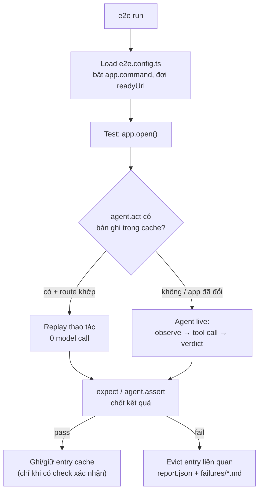

# e2e-testing — Kiểm thử end-to-end bằng agent AI (tester-army/e2e)

> **Một câu:** mô tả *mục tiêu* bằng ngôn ngữ tự nhiên → agent tự lái app tới đích → bạn
> *chốt kết quả* bằng locator + assertion chính xác trong cùng file test.
>
> **Nguồn:** [tester-army/e2e](https://github.com/tester-army/e2e) @ `60bf04d` (2026-10-05) ·
> `e2e` 0.17.0 · `@e2e-dev/web` 0.12.0 · `@e2e-dev/mobile` 0.9.2 · Apache-2.0.
>
> ⚠️ **Pre-1.0:** API và config còn đổi giữa các bản minor. Khi project **đã cài** `e2e`, nguồn
> sự thật khớp đúng version là `npx e2e guide <topic>` và `node_modules/e2e/docs/` — skill này là
> bản tóm tắt + kinh nghiệm dùng. Thấy lệch → tin bản đã cài.

---

## 0. Mô hình tư duy (đọc trước khi viết dòng nào)

| Khái niệm | Ý nghĩa |
|---|---|
| **Target** | 1 engine (`web()` / `mobile()`) + 1 app (`url`, `command`...). Runner tự bật app, đợi sẵn sàng, tắt khi xong. |
| **4 fixture** | `app` (mở/đóng/reset app) · `screen` (locator + action chính xác) · `agent` (bước AI) · `browser`/`device` (thứ chỉ engine đó có). |
| **Agent step** | `agent.act` = 1 mục tiêu, nhiều thao tác. `assert`/`waitFor`/`extract` = 1 câu hỏi về màn hình. Mỗi lần gọi là 1 phiên độc lập, có deadline + budget. |
| **Replay cache** | `act` pass **và** được 1 check phía sau xác nhận → ghi lại thao tác; lần sau phát lại **không gọi model** cho tới khi app đổi. Judgment (`assert`/`waitFor`/`extract`) luôn chạy live. |
| **Không agent step** | Không cần model, không tốn tiền — chạy như Playwright thuần. |



---

## 1. Khi nào dùng — và khi nào KHÔNG

| Tình huống | Chọn |
|---|---|
| Luồng người dùng thật xuyên nhiều màn (đăng ký, checkout, phân quyền) trên web/mobile | **e2e** ✅ |
| UI hay đổi markup, test Playwright vỡ liên tục vì selector | **e2e** — để agent lo phần giữa, giữ assertion chính xác |
| Cần săn bug khi chưa có test (branch mới, app lạ) | **`e2e explore`** / bug bash |
| Một hàm/lớp/thuật toán thuần | **[unit-tests.md](../unit-tests.md)**, không phải e2e |
| Chỉ kiểm API | e2e được (test chỉ dùng `app` + `fetch`, 0 model) — hoặc giữ test API sẵn có |
| Visual diff từng pixel (`toHaveScreenshot`) | **Chưa có** trong e2e — giữ Playwright cho phần đó |
| Dữ liệu cực nhạy cảm, không được gửi màn hình ra ngoài | Chỉ dùng phần deterministic, hoặc model **local** (§8) |

---

## 2. Chọn đúng công cụ cho từng dòng test

| Muốn… | Dùng | Vì sao |
|---|---|---|
| Đi qua một luồng có thể đổi giao diện | `agent.act('mục tiêu', { params })` | Agent tự tìm đường; được cache |
| Điền **đúng một giá trị**, bấm **đúng một nút**, đếm **đúng một số** | `screen.getBy…().fill/tap` | Chính xác, 0 model |
| Kiểm một **sự thật** cố định (text, URL, số lượng) | `await expect(locator).toHaveText(...)` | Retry tới `assertionTimeout`; giúp cache ghi lại |
| Kiểm một **ý nghĩa** chỉ phán đoán được (layout vỡ, "hiển thị lỗi thân thiện") | `agent.assert('…')` (+ `vision: true` nếu nằm ở pixel) | 2 model call, không cache |
| Đợi việc chạy lâu (export, build) | `agent.waitFor('…', { timeout })` hoặc `expect(...).toBeVisible({ timeout })` | Ưu tiên `expect` nếu có locator |
| Đọc dữ liệu có cấu trúc từ màn hình | `agent.extract('…', { schema: z.object(...) })` rồi `expect(value)` | Kết quả đã validate |
| Giá trị chỉ ổn định sau một lúc (DB, job nền) | `expect.poll(() => read()).toBe(...)` | Không bao giờ `sleep` |
| Cookie, route mock, iframe, dialog, download | `browser.*` (import `test` từ `@e2e-dev/web`) | Chỉ có ở browser |

**Quy tắc vàng:** *Agent làm luồng, `expect` chốt kết quả.* Mỗi `agent.act` phải có một check
ngay sau nó — vừa đúng nghĩa test, vừa là điều kiện để cache ghi lại.

---

## 3. Quickstart

```bash
npx e2e init          # chọn engine (web/mobile) + model provider (None nếu không dùng AI)
# --yes: Playwright + Vercel AI Gateway, cài skill, đăng ký MCP, KHÔNG cài deps
```

```ts
// e2e.config.ts
import type { E2EConfig } from 'e2e';
import { web } from '@e2e-dev/web';
import { gateway } from 'ai';

export default {
  targets: [
    {
      engine: web(),
      app: {
        url: 'http://127.0.0.1:3000',
        command: { executable: 'pnpm', args: ['dev'], log: '.e2e/logs/app.log' },
      },
    },
  ],
  agents: {
    default: {
      model: gateway('openai/gpt-6-luna-fast'), // instance AI SDK, KHÔNG phải string
      system: 'You are a thorough QA agent. Verify every outcome on screen.',
    },
  },
  credentials: {
    admin: { username: 'admin@example.test', password: process.env.ADMIN_PASSWORD ?? '' },
  },
} satisfies E2EConfig;
```

```ts
// tests/billing.e2e.ts
import { test } from '@e2e-dev/web';
import { expect } from 'e2e';

test('a member upgrades to Pro', async ({ app, agent, screen, browser }) => {
  await app.open('/settings/billing');
  await agent.act('upgrade the workspace to the Pro plan');
  await expect(screen.getByRole('status')).toContainText('Pro');   // chốt + cho phép cache
  await expect(browser).toHaveURL('/settings/billing');
});
```

```bash
export ADMIN_PASSWORD='…'          # ≥ 6 ký tự — thiếu thì MỌI lệnh fail INVALID_CONFIG lúc load config
npx e2e run tests/billing.e2e.ts
```

Yêu cầu: Node ≥ 24.8 (hoặc ≥ 22.22.3 trên dòng 22). Chi tiết provider/subscription/mobile →
[setup.md](setup.md).

---

## 4. Workflow chuẩn (copy làm checklist)

```
- [ ] 1. Khảo sát: có e2e.config.ts / .mts? glob `tests` (mặc định tests/**/*.e2e.ts)?
         gói `e2e` trong package.json? Không có → setup (setup.md).
- [ ] 2. Học màn hình TRƯỚC khi viết: route, label, role, text nút. Đọc component,
         `--headed`, hoặc `e2e mcp` → open_session / observe / locate để lấy đúng tên.
- [ ] 3. Viết tests/<feature>.e2e.ts: agent.act cho luồng (1 goal/lần) + expect ngay sau.
         Giá trị chính xác → screen. Dữ liệu tạo ra → tên duy nhất + afterEach dọn.
- [ ] 4. Chạy 1 file: npx e2e run tests/<feature>.e2e.ts
- [ ] 5. Fail → đọc code lỗi + .e2e/failures/*.md (--reporter list,markdown). Sửa locator,
         expectation, hoặc app. KHÔNG thêm sleep.
- [ ] 6. Ổn định → --repeat-each 10 --retries 0 --no-cache để đo flaky; commit .e2e/cache/
         nếu muốn CI replay; đưa vào CI (running-ci.md).
```

---

## 5. Luật cứng

1. Chạy CLI bằng `npx e2e …` hoặc `pnpm exec e2e …`. Với script `"test:e2e": "e2e run"`:
   pnpm viết `pnpm test:e2e --headed` (KHÔNG `-- --headed` → exit 2); npm dùng `npm exec -- e2e run --headed`.
2. Config: `export default { … } satisfies E2EConfig` với `import type { E2EConfig } from 'e2e'`.
   `targets` bắt buộc; app khai báo **trong target** (`{ engine: web(), app: { url, command } }`).
   Key lạ (`webServer`, `baseURL`, `use`, `projects`, `services`) → `INVALID_CONFIG`.
3. Import `test`/`describe`/hooks/`expect`/`credentials`/`secrets` từ `'e2e'`. Test dùng fixture
   `browser` → import `test`/`describe`/hooks từ `'@e2e-dev/web'`; `device` → `'@e2e-dev/mobile'`.
4. Config + test là **ES module**: không `require`, không `module.exports`.
5. Locator lười, phải khớp **đúng 1** node: 2 node → `LOCATOR_AMBIGUOUS` ngay; 0 node → action/
   assertion đợi tới timeout rồi `LOCATOR_NOT_FOUND`. So text là **khớp nguyên chuỗi, phân biệt
   hoa thường** (khác Playwright): `'Save'` không khớp `Save changes` → dùng `{ exact: false }`/RegExp.
6. Read (`textContent()`, `count()`) **không đợi**. Giá trị cần thời gian ổn định → matcher hoặc `expect.poll`.
7. `await` **mọi** lời gọi `app`/`screen`/`agent`/`expect`/`expect.poll` (thiếu → `STEP_NOT_AWAITED`).
8. **Secret không bao giờ nằm trong code test.** Tài khoản → `credentials`, giá trị nhạy cảm khác →
   `secrets`; lấy bằng `credentials.user('admin').password` / `secrets.get('stripe-key')` và chỉ
   đưa handle `Secret` vào `fill()` hoặc `params` của `agent.act`.
9. Instruction cho agent: 1 mục tiêu/`act`, dùng **chữ hiện trên màn hình**, giá trị thật đi qua
   `params` (`'invite {email}'`). Judge **ý nghĩa**, không judge câu chữ model sinh ra (`toContain`).
10. `.e2e/` là output (`report.json`, `artifacts/`, `cache/`, `logs/`): đọc, **không sửa tay**.
11. Không `test.only` vào CI (`ONLY_IN_CI`). Không `sleep`/vòng lặp polling tự viết.

---

## 6. Viết instruction mà model làm được

```ts
// ❌ mơ hồ, nhồi nhiều goal, giá trị viết cứng, mô tả cơ chế chờ
await agent.act('go to settings, wait for it to load, then upgrade and enter ada@x.com');

// ✅ 1 goal · chữ trên màn hình · giá trị qua params · chốt ngay sau
await agent.act('open the Billing tab');
await agent.act('invite {email} as an editor', { params: { email: 'ada@example.test' } });
await expect(screen.getByRole('status')).toHaveText('Invitation sent to ada@example.test');
```

Step fail? Sửa theo thứ tự: **(1) câu goal** (dùng đúng nhãn màn hình) → **(2) `context`**
(từ vựng của app) → **(3) `system`/persona** → **(4) tools** (API test) → **(5) model**.
Chi tiết + budget + persona → [agent.md](agent.md).

---

## 7. Chi phí & replay cache (tóm tắt)

| Lời gọi | Model call | Timeout mặc định |
|---|---:|---|
| `act` | ≤ `maxModelCalls` (25) | `timeout` của config (120 s) |
| `assert` / `extract` | 2 | 30 s |
| `waitFor` | ≤ 25 | 30 s |

- Cache mặc định `read-write` local, `read-only` trong CI. Entry chỉ được ghi khi một **verification
  phía sau** pass (`expect` locator/engine matcher, `waitFor`, `waitForURL`, `agent.assert`, `agent.waitFor`).
  `expect` giá trị thuần, `expect.poll`, `extract`, một `act` khác → **không** xác nhận.
- Muốn CI replay miễn phí: bỏ dòng `.e2e/cache/` khỏi `.gitignore`, commit cache; thêm `--strict-cache`
  để CI fail (`REPLAY_STALE`) thay vì âm thầm tiêu model khi bản ghi cũ.
- `--debug` in bảng chi phí từng step; `--ai-trace` ghi mọi model call (đọc bằng `npx unbox-ai`, đừng mở file thô).

---

## 8. Bảo mật & dữ liệu (đừng bỏ qua)

- Model nhận **cây accessibility đã redact** (role, name, text, state), URL đã redact, screenshot khi
  cần (đã che trường bảo mật). Không nhận HTML thô, cookie, header, env, giá trị `Secret`. Sau khi
  điền secret, pixel bị **giữ lại** suốt phiên và `app.screenshot()` → `POLICY_DENIED`.
- Nội dung app được coi là **bằng chứng không tin cậy**; runner validate mọi tool call. Nhưng code
  test/config/tools/reporter chạy với **quyền OS của bạn** — không sandbox. PR từ người ngoài → chạy
  trong sandbox không có secret/write token. Cache entry dùng chung cũng phải review như code.
- Màn hình (kể cả dữ liệu khách) đi tới provider. Môi trường có PII/compliance → dùng provider có
  thoả thuận phù hợp hoặc model **local** (`@ai-sdk/openai-compatible` trỏ server nội bộ); `explore`/
  bug bash trên site thật = **chỉ đọc** (không signup/submit, không chuỗi giống injection).
- Video **không** được che → không quay khi secret đang hiện.
- Telemetry ẩn danh bật mặc định: tắt bằng `npx e2e telemetry disable` hoặc `E2E_TELEMETRY_DISABLED=1`.
- `npx e2e feedback` gửi phản hồi về chính e2e cho TesterArmy: chỉ khi user đồng ý; không bao giờ
  dán nội dung app, URL riêng, test file, credentials (`--dry-run` để xem trước).

---

## 9. Lỗi hay gặp → sửa nhanh

| Code | Thường do | Sửa |
|---|---|---|
| `INVALID_CONFIG` | Key lạ/kiểu Playwright, model là string, password < 6 ký tự (env chưa set) | Đọc message, sửa key; `export ADMIN_PASSWORD=…` |
| `APP_UNREACHABLE` | `app.command` không trả `readyUrl` kịp | Đặt `command.log`, đọc log; kiểm port/env/`startupTimeout` |
| `APP_ALREADY_RUNNING` | Đã có server chiếm `url` | Tắt nó, hoặc `reuseExisting: true` (local) |
| `LOCATOR_NOT_FOUND` | Sai role/name, text không khớp nguyên văn, trong iframe, chưa `app.open()` | Đọc accessible name; `exact: false`; `browser.frameLocator` |
| `LOCATOR_AMBIGUOUS` | 2 node khớp | Scope container, `filter`, `{ visible: true }`, `first()` |
| `ASSERTION_FAILED` | Kỳ vọng sai / state > 5 s mới ổn | So với report; `{ timeout }`; với `agent.assert` sửa câu hỏi |
| `ASSERTION_INCONCLUSIVE` | Hỏi thứ màn hình không hiển thị | Tới đúng màn trước; `vision: true` nếu ở pixel |
| `STEP_TIMEOUT` / `STEP_BUDGET_EXHAUSTED` | Goal quá to/mơ hồ, model chậm | Chia nhỏ goal, thêm `context`, nâng budget có chủ đích |
| `MODEL_UNAVAILABLE` / `MODEL_PROVIDER_FAILED` | Chưa có model / sai key, hết quota | Tạo instance model; kiểm key; exit 3 mới đáng retry |
| `STEP_NOT_AWAITED` | Quên `await` | `await` đúng dòng trong code frame |
| `POLICY_DENIED` | Đọc giá trị password, screenshot sau khi điền secret, URL `file:`/`data:` | Assert kết quả, không assert giá trị; chụp trước khi điền |
| `REPLAY_STALE` | `--strict-cache` + bản ghi cũ | Chạy lại read-write local, commit entry mới |

Exit code: `0` pass · `1` test fail · `2` lỗi CLI/config/policy (**không retry**) · `3` engine/app/
provider (**đáng retry**) · `4` lỗi runner · `130` bị ngắt. Bảng đầy đủ → [debugging.md](debugging.md).

---

## 10. Bản đồ topic → file

Đọc **đúng file cho việc đang làm** trước khi viết code (CLI in nội dung gốc: `npx e2e guide <topic>`).

| Việc | File |
|---|---|
| Thêm e2e vào project, viết config, provider/subscription, app tự khởi động, mobile, env | [setup.md](setup.md) |
| Viết/sửa test: fixture, hook, locator, action, `expect`, session đăng nhập, `browser`, công thức mẫu | [writing-tests.md](writing-tests.md) |
| Bước `agent.*`: chọn model, persona, budget, replay cache, tools, executor | [agent.md](agent.md) |
| CLI, cờ `run`/`list`, reporter, `report.json`, exit code, CI GitHub Actions, PR comment | [running-ci.md](running-ci.md) |
| Run fail: đọc lỗi, jq report, bảng mã lỗi, flaky | [debugging.md](debugging.md) |
| `e2e explore`, `e2e mcp` cho coding agent, bug bash song song | [explore-mcp-bugbash.md](explore-mcp-bugbash.md) |
| Chuyển từ Playwright (map API, khác biệt "by design", thứ chưa có) | [migrate-playwright.md](migrate-playwright.md) |

Ngoài phạm vi các file trên: docs đầy đủ ship kèm gói (`node_modules/e2e/docs`, link `/reference/cli`
= `docs/reference/cli.mdx`) hoặc https://e2e.tester.army/docs. Project mẫu chạy được (Vite, Next.js,
Expo, SwiftUI): https://github.com/tester-army/e2e/tree/main/examples.

---

## 11. Anti-patterns

- `act` không có check phía sau → không bao giờ được cache, tốn model mỗi lần, test không chứng minh gì.
- Nhồi cả luồng vào một `act` ("đăng ký, xác nhận email, nâng cấp, mời bạn") → `STEP_BUDGET_EXHAUSTED`.
- `agent.assert` so câu chữ chính xác của model → flaky; judge sự thật + thêm `expect` deterministic.
- `await new Promise(r => setTimeout(r, 3000))` → thay bằng matcher có `timeout`/`expect.poll`.
- `browser.locator('.btn-primary')` khi app thiếu accessible name → thêm `aria-label`/heading vào app.
- Viết mật khẩu/API key vào test hoặc template string (`${process.env.KEY}`) → dùng handle `Secret`.
- Dùng dữ liệu cố định (`'Invoice 1'`) không dọn → retry/replay vấp dữ liệu cũ; dùng tên duy nhất + `afterEach`.
- Đưa `Date.now()`/email mới thẳng vào `params` → cache miss mọi run; bọc `unique(value)` (từ `'e2e'`).
- Bật `retries` để che flaky → đo bằng `--repeat-each 10 --retries 0`, sửa gốc.
- Chạy explore/bug bash ghi dữ liệu trên production dùng chung → chỉ đọc, tài khoản seed riêng.
- Sửa tay file trong `.e2e/` hoặc tin `explore` finding là bug khi chưa có repro test fail.
- Copy y nguyên config Playwright (`webServer`, `use.baseURL`) → `INVALID_CONFIG`; xem migrate-playwright.

---

## 12. Xong khi

- [ ] `npx e2e run` pass cục bộ; mỗi `act` có check ngay sau; không `sleep`, không `test.only`.
- [ ] `package.json` có `"test:e2e": "e2e run"`; `.gitignore` có output `.e2e/` (quyết định rõ có commit `.e2e/cache/` không).
- [ ] Credentials/secrets lấy từ env; không giá trị nhạy cảm trong code/report.
- [ ] Flaky đã đo (`--repeat-each 10 --retries 0 --no-cache`) và = 0.
- [ ] CI chạy cả suite (kể cả agent step) trên PR, upload `.e2e/artifacts` khi fail, key model qua secret.

---

## Liên quan

- [../unit-tests.md](../unit-tests.md) - test đơn vị (tầng dưới e2e). `frontend:testing` - triết lý ưu tiên E2E, ít mock.
- `/cicd` - gắn job e2e vào pipeline. `/repo-scan` — quét repo/gói lạ trước khi cài.
- Eval LLM (golden dataset): xem [../cross-cutting.md](../cross-cutting.md) mục AI, nếu app của bạn chính là app LLM (eval chất lượng model, khác với test UI).

## Nguồn & giấy phép

Biên soạn lại (dịch, rút gọn, tổ chức lại, bổ sung bảng quyết định/anti-pattern/công thức) từ skill
chính thức `skills/e2e` và `docs/` của [tester-army/e2e](https://github.com/tester-army/e2e),
Apache License 2.0. NOTICE gốc: *"e2e — Copyright 2026 TesterArmy, Inc. This product includes
software developed at TesterArmy, Inc. (https://tester.army)."* Mọi thay đổi so với bản gốc là của
repo này; bản gốc tiếng Anh luôn là tham chiếu chuẩn.
