<div align="center">

# Hệ thống cảnh báo thiên tai

**Cảnh báo kịp thời theo vị trí · Sơ tán an toàn · Cầu cứu một chạm**

Tài liệu dự án · Học phần *Phát triển mã nguồn mở (PTMNM)*


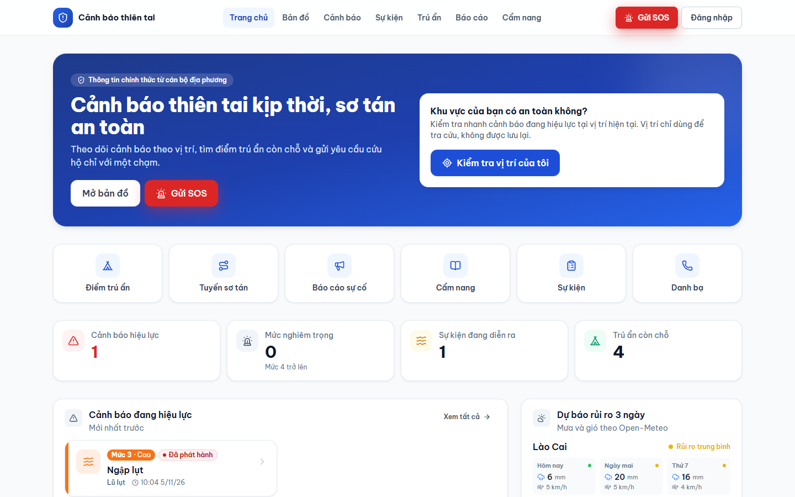

</div>

> Cập nhật: 2026-11-05 · Áp dụng cho nhánh `main` · Ảnh chụp từ dữ liệu demo (Nha Trang, Khánh Hoà)

## Mục lục

1. [Giới thiệu](#giới-thiệu)
2. [Hình ảnh minh họa](#hình-ảnh-minh-họa)
3. [Sơ đồ hệ thống](#sơ-đồ-hệ-thống)
4. [Bắt đầu nhanh](#bắt-đầu-nhanh)
5. [Danh mục tài liệu](#danh-mục-tài-liệu)
6. [Công nghệ sử dụng](#công-nghệ-sử-dụng)
7. [Cấu trúc thư mục `docs/`](#cấu-trúc-thư-mục-docs)
8. [Quy ước viết tài liệu](#quy-ước-viết-tài-liệu)

---

## Giới thiệu

Hệ thống giúp cán bộ địa phương **phát hành cảnh báo thiên tai theo vùng ảnh hưởng vẽ trên bản đồ**. Chỉ người có vị trí quan tâm nằm trong vùng mới nhận thông báo realtime.
Người dân xem điểm trú ẩn còn chỗ, tuyến sơ tán, gửi báo cáo hiện trường và **gửi SOS không cần đăng nhập**. Đội cứu hộ nhận nhiệm vụ ngay trên điện thoại.

| Vai trò | Cổng | Chức năng chính |
|---|---|---|
| Khách | `/` | Bản đồ, cảnh báo công khai, điểm trú ẩn, cẩm nang, danh bạ khẩn cấp, SOS nhanh |
| Người dân | `/`, `/me` | Vị trí quan tâm, thông báo theo vị trí, báo cáo kèm ảnh/video, theo dõi SOS |
| Đội cứu hộ | `/rescuer` | Nhiệm vụ được giao, chỉ đường tới người gặp nạn, cập nhật tiến trình cứu hộ |
| Cán bộ quản lý | `/officer` | Tạo và duyệt cảnh báo, duyệt báo cáo, điều phối SOS, sự kiện, trú ẩn, thống kê |
| Quản trị viên | `/admin` | Người dùng, vai trò, danh mục, nhật ký hoạt động; dùng được cả cổng cán bộ |

**Điểm nổi bật**

- **Geofencing bằng MariaDB GIS:** đối chiếu vùng cảnh báo với vị trí quan tâm bằng `ST_Contains`, SRID 4326.
- **Vòng đời cảnh báo có phiên bản:** Nháp, Chờ duyệt, Phát hành, Cập nhật, Kết thúc. Mỗi thay đổi đều lưu phiên bản.
- **Realtime qua Laravel Reverb:** bản đồ, thông báo và trạng thái SOS cập nhật không cần tải lại trang.
- **Dữ liệu mở:** Open-Meteo (mưa, gió) và USGS (động đất) lấy định kỳ. Mưa vượt ngưỡng thì tự đề xuất cảnh báo lũ.
- **Bản đồ mở, giữ chủ quyền:** bản đồ nền vector nhãn tiếng Việt, hiển thị quần đảo Hoàng Sa, Trường Sa thuộc Việt Nam.
- **Chi phí 0 đồng:** toàn bộ thành phần là mã nguồn mở, không dùng Google Maps, không dùng SMS.

---

## Hình ảnh minh họa

### Cổng công khai và người dân

<table>
  <tr>
    <td width="50%" valign="top">
      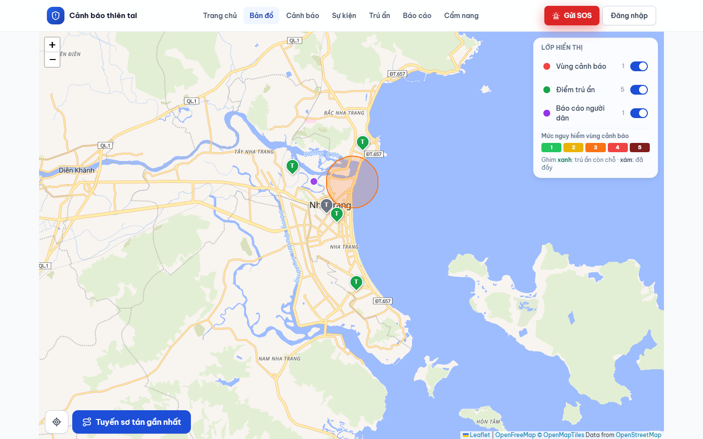<br>
      <b>Bản đồ thiên tai</b> · Bật/tắt lớp vùng cảnh báo, điểm trú ẩn, báo cáo người dân; tô màu theo mức nguy hiểm 1-5.
    </td>
    <td width="50%" valign="top">
      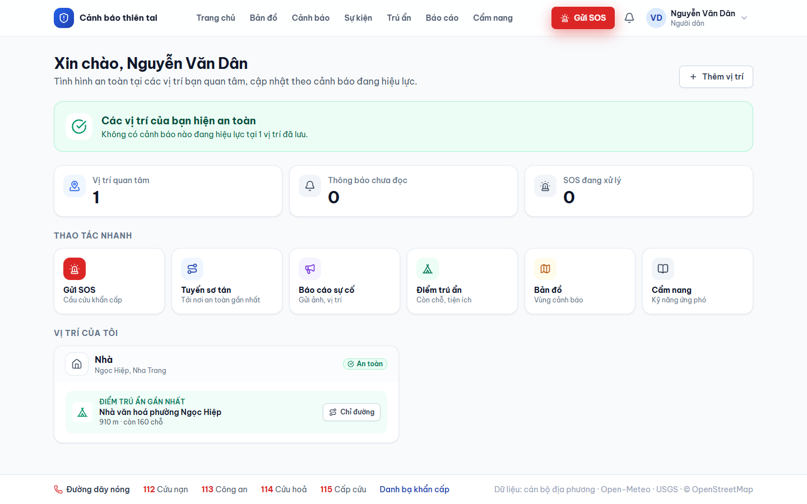<br>
      <b>Trang của tôi</b> · Tình trạng an toàn tại từng vị trí quan tâm và điểm trú ẩn gần nhất còn chỗ.
    </td>
  </tr>
</table>

<table>
  <tr>
    <td width="34%" align="center" valign="top">
      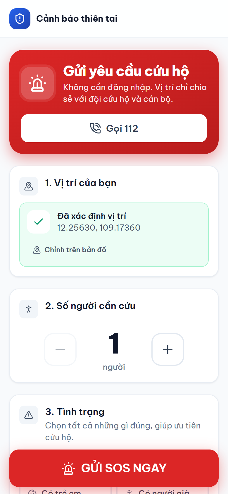<br>
      <b>SOS một chạm</b> · Tự lấy GPS, chọn số người và tình trạng; không cần đăng nhập.
    </td>
    <td width="33%" align="center" valign="top">
      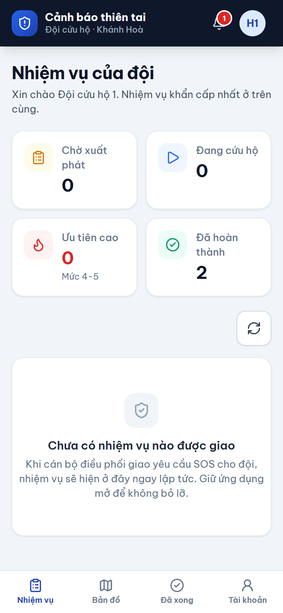<br>
      <b>Ứng dụng đội cứu hộ</b> · Nhiệm vụ xếp theo độ khẩn cấp, nhận realtime khi được phân công.
    </td>
    <td width="33%" valign="top">
      <b>Giao diện responsive</b><br><br>
      Cổng người dân và cổng cứu hộ thiết kế ưu tiên điện thoại: nút lớn, thanh điều hướng dưới, nút SOS luôn hiện.<br><br>
      Cổng cán bộ và quản trị tối ưu cho màn hình lớn, dùng được trên máy tính bảng.
    </td>
  </tr>
</table>

### Cổng cán bộ điều hành

<table>
  <tr>
    <td width="50%" valign="top">
      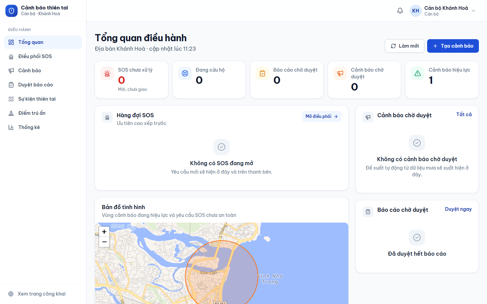<br>
      <b>Tổng quan điều hành</b> · SOS chưa xử lý, báo cáo và cảnh báo chờ duyệt, bản đồ tình hình địa bàn.
    </td>
    <td width="50%" valign="top">
      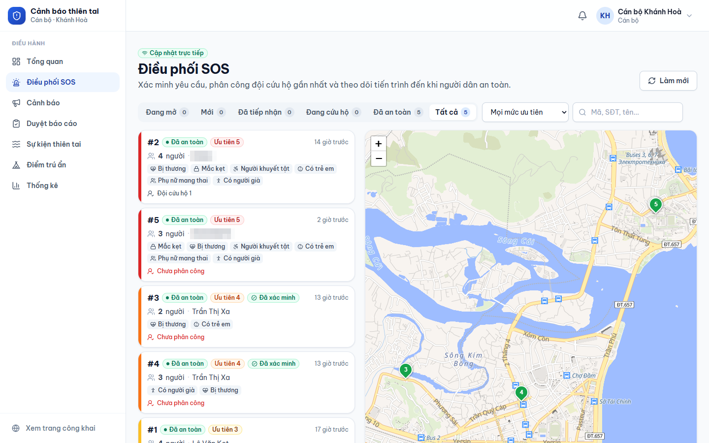<br>
      <b>Điều phối SOS</b> · Lọc theo trạng thái và ưu tiên, phân công đội cứu hộ gần nhất, theo dõi trên bản đồ.
    </td>
  </tr>
  <tr>
    <td width="50%" valign="top">
      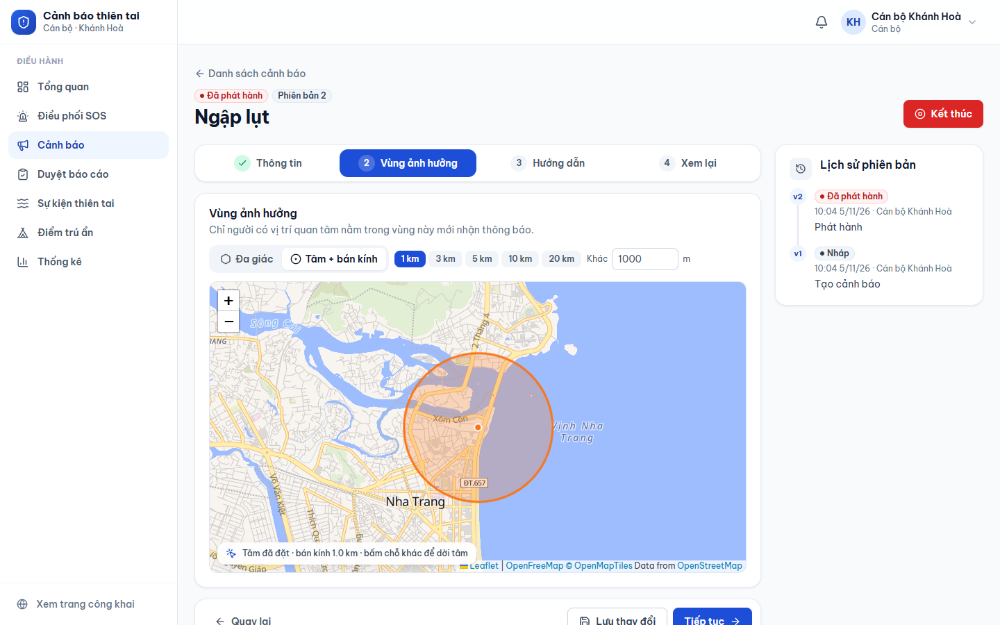<br>
      <b>Soạn cảnh báo</b> · Vẽ vùng ảnh hưởng (đa giác hoặc tâm + bán kính), lịch sử phiên bản bên phải.
    </td>
    <td width="50%" valign="top">
      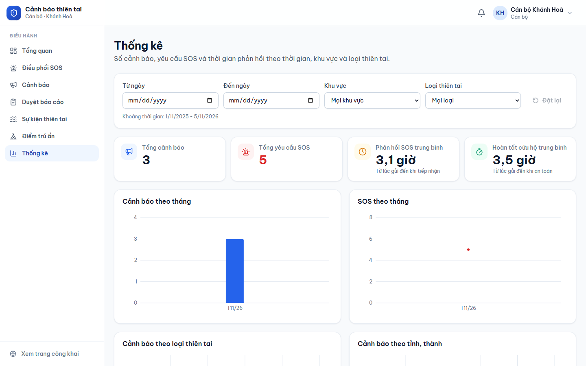<br>
      <b>Thống kê</b> · Cảnh báo theo tháng, loại, tỉnh; số SOS và thời gian phản hồi trung bình.
    </td>
  </tr>
</table>

### Cổng quản trị

<p align="center">
  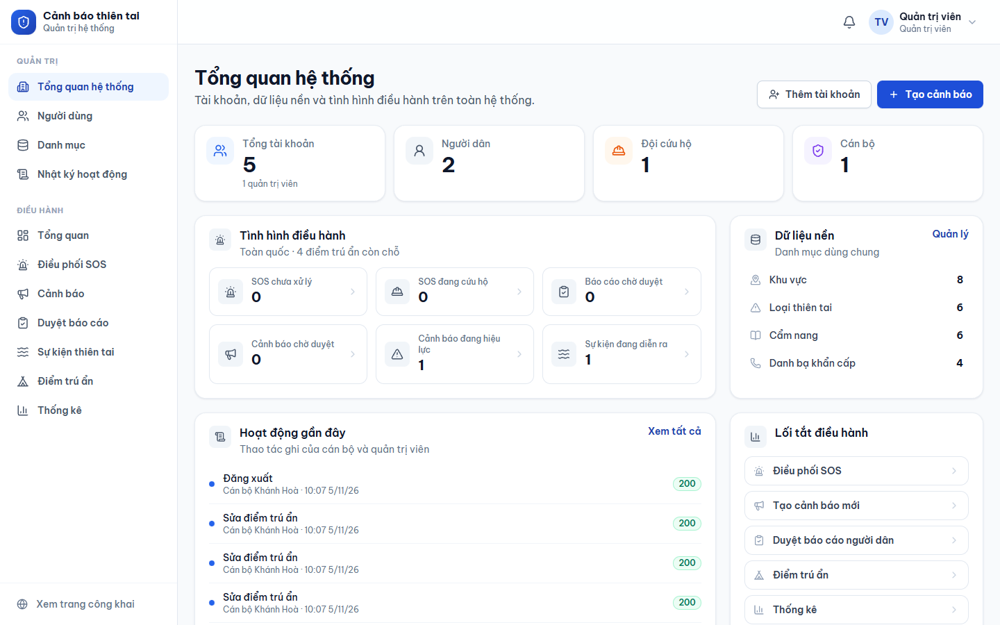<br>
  <b>Tổng quan hệ thống</b> · Tài khoản theo vai trò, dữ liệu nền, hoạt động gần đây từ nhật ký thao tác.
</p>

---

## Sơ đồ hệ thống

Mã nguồn sơ đồ (SVG) nằm trong [`06-design/`](06-design/). Sửa trực tiếp file SVG khi kiến trúc thay đổi.

### Kiến trúc triển khai

<p align="center">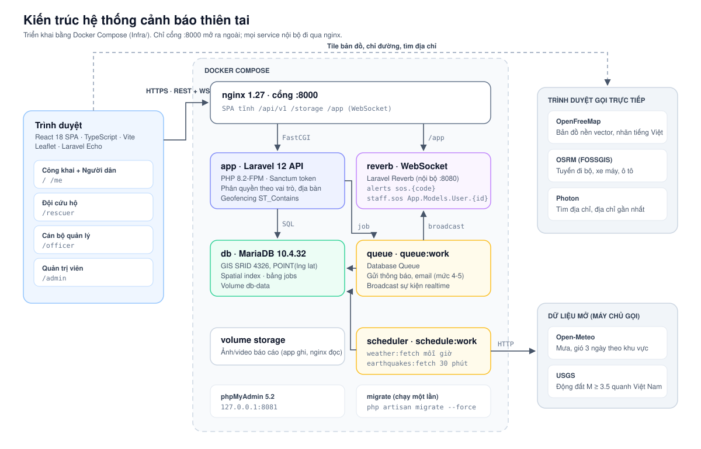</p>

- **nginx** là cổng duy nhất mở ra ngoài (`:8000`): phục vụ SPA, chuyển `/api/v1` tới PHP-FPM, `/app` tới Reverb, `/storage` tới file upload.
- **queue** gửi thông báo và broadcast; **scheduler** lấy dữ liệu Open-Meteo, USGS định kỳ.
- Bản đồ nền, chỉ đường và tìm địa chỉ do **trình duyệt gọi trực tiếp**, không qua máy chủ.

### Vòng đời cảnh báo và geofencing

<p align="center">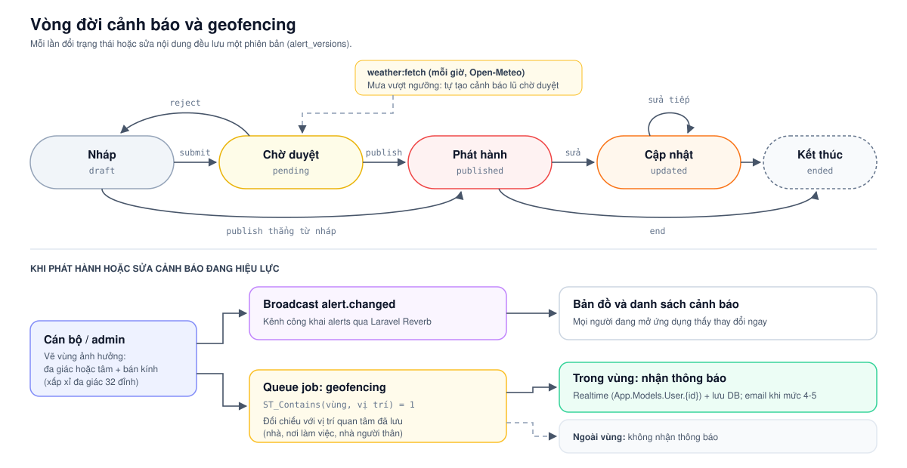</p>

### Luồng xử lý SOS

<p align="center">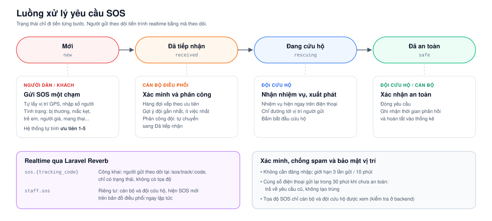</p>

Chi tiết endpoint, kênh realtime và quy tắc chuyển trạng thái: [Backend API v1](02-ky-thuat/backend-api.md).

---

## Bắt đầu nhanh

Chạy toàn bộ hệ thống bằng Docker (cần Docker Desktop hoặc Docker Engine + Compose v2.20+):

```bash
cd Infra
cp .env.example .env              # điền APP_KEY, REVERB_APP_KEY/SECRET, mật khẩu DB
docker compose up -d --build
docker compose exec app php artisan db:seed --force   # dữ liệu demo, chạy một lần
```

Mở `http://localhost:8000`. Tài khoản demo: `admin`, `officer`, `rescuer`, `citizen`, `outsider` `@demo.vn`, mật khẩu `password`.

| Tôi muốn... | Đọc |
|---|---|
| Chạy toàn bộ hệ thống trên máy | [Cách A - Docker trên máy](04-van-hanh/huong-dan-su-dung-va-trien-khai.md#23-cách-a---chạy-toàn-bộ-bằng-docker-trên-máy) |
| Phát triển giao diện với hot reload | [Cách B - Backend Docker + Frontend dev](04-van-hanh/huong-dan-su-dung-va-trien-khai.md#24-cách-b---backend-docker--frontend-dev-hot-reload) |
| Chạy bằng XAMPP, không dùng Docker | [Cách C - XAMPP](04-van-hanh/huong-dan-su-dung-va-trien-khai.md#25-cách-c---chạy-bằng-xampp-không-docker) |
| Triển khai lên VPS | [Cách D - VPS](04-van-hanh/huong-dan-su-dung-va-trien-khai.md#27-cách-d---triển-khai-lên-vps-docker) |
| Biết quyền của từng vai trò | [Vai trò, cổng và tài khoản demo](04-van-hanh/huong-dan-su-dung-va-trien-khai.md#11-vai-trò-cổng-và-tài-khoản-demo) |
| Trình diễn hệ thống trong 5-7 phút | [Kịch bản demo](04-van-hanh/huong-dan-su-dung-va-trien-khai.md#110-kịch-bản-demo-đầy-đủ-5-7-phút-dữ-liệu-nha-trang) |
| Tích hợp hoặc gọi API | [Backend API v1](02-ky-thuat/backend-api.md) |
| Chạy kiểm thử | [Chạy kiểm thử](04-van-hanh/huong-dan-su-dung-va-trien-khai.md#26-chạy-kiểm-thử) |
| Gỡ lỗi khi cài đặt hoặc chạy | [Sự cố thường gặp](04-van-hanh/huong-dan-su-dung-va-trien-khai.md#28-sự-cố-thường-gặp) |

---

## Danh mục tài liệu

| Tài liệu | Nhóm | Nội dung chính | Người đọc |
|---|---|---|---|
| [Backend API v1](02-ky-thuat/backend-api.md) | Kỹ thuật | Quy ước chung, vùng ảnh hưởng, vòng đời cảnh báo, trạng thái SOS, endpoint theo quyền, kênh realtime, tác vụ nền | Lập trình viên, bên tích hợp |
| [Hướng dẫn sử dụng và triển khai](04-van-hanh/huong-dan-su-dung-va-trien-khai.md) | Vận hành | Chức năng theo vai trò; chạy local, Docker, XAMPP, VPS; kiểm thử; xử lý sự cố | Người dùng, giảng viên, người vận hành |
| [Sơ đồ kiến trúc](06-design/kien-truc-he-thong.svg) | Thiết kế | Các service Docker Compose, luồng request, dịch vụ bên ngoài | Lập trình viên, người vận hành |
| [Sơ đồ vòng đời cảnh báo](06-design/vong-doi-canh-bao.svg) | Thiết kế | Trạng thái cảnh báo, đề xuất tự động, geofencing và gửi thông báo | Lập trình viên, cán bộ nghiệp vụ |
| [Sơ đồ luồng SOS](06-design/luong-sos.svg) | Thiết kế | Trạng thái SOS, vai trò xử lý từng bước, realtime, chống spam | Lập trình viên, cán bộ nghiệp vụ |

<details>
<summary><b>Mục chính trong Backend API v1</b></summary>

- [Quy ước chung](02-ky-thuat/backend-api.md#quy-uoc-chung): tọa độ, vai trò, địa bàn, mã lỗi, lọc thời gian.
- [Vùng ảnh hưởng cảnh báo](02-ky-thuat/backend-api.md#vung-anh-huong-canh-bao-area): định dạng đa giác và hình tròn.
- [Vòng đời cảnh báo](02-ky-thuat/backend-api.md#vong-doi-canh-bao) và [Trạng thái SOS](02-ky-thuat/backend-api.md#trang-thai-sos).
- [Endpoint](02-ky-thuat/backend-api.md#endpoint): công khai, đã đăng nhập, cứu hộ, cán bộ, admin.
- [Realtime (Reverb)](02-ky-thuat/backend-api.md#realtime-reverb) và [Tác vụ nền](02-ky-thuat/backend-api.md#tac-vu-nen).

</details>

<details>
<summary><b>Mục chính trong Hướng dẫn sử dụng và triển khai</b></summary>

**Phần 1 - Chức năng**

- [1.2. Khách (không cần đăng nhập)](04-van-hanh/huong-dan-su-dung-va-trien-khai.md#12-chức-năng-cho-khách-không-cần-đăng-nhập)
- [1.4. Người dân](04-van-hanh/huong-dan-su-dung-va-trien-khai.md#14-chức-năng-cho-người-dân-citizen)
- [1.5. Đội cứu hộ](04-van-hanh/huong-dan-su-dung-va-trien-khai.md#15-chức-năng-cho-đội-cứu-hộ-rescuer)
- [1.6. Cán bộ quản lý](04-van-hanh/huong-dan-su-dung-va-trien-khai.md#16-chức-năng-cho-cán-bộ-quản-lý-officer)
- [1.7. Quản trị viên](04-van-hanh/huong-dan-su-dung-va-trien-khai.md#17-chức-năng-cho-quản-trị-viên-admin)
- [1.8. Các tiến trình chạy ngầm](04-van-hanh/huong-dan-su-dung-va-trien-khai.md#18-các-tiến-trình-chạy-ngầm)
- [1.9. Bản đồ nền và chủ quyền Việt Nam](04-van-hanh/huong-dan-su-dung-va-trien-khai.md#19-bản-đồ-nền-và-chủ-quyền-việt-nam)
- [1.11. Giới hạn hiện tại](04-van-hanh/huong-dan-su-dung-va-trien-khai.md#111-giới-hạn-hiện-tại)

**Phần 2 - Cài đặt và vận hành**

- [2.1. Chọn cách chạy](04-van-hanh/huong-dan-su-dung-va-trien-khai.md#21-chọn-cách-chạy)
- [2.2. Yêu cầu phần mềm](04-van-hanh/huong-dan-su-dung-va-trien-khai.md#22-yêu-cầu-phần-mềm)
- [2.7. Triển khai VPS: bảo mật SSH, Docker, cập nhật, HTTPS](04-van-hanh/huong-dan-su-dung-va-trien-khai.md#27-cách-d---triển-khai-lên-vps-docker)

</details>

**README theo module** (đặt cạnh mã nguồn)

| Module | README | Nội dung |
|---|---|---|
| Backend | [Backend/README.md](../Backend/README.md) | Cài đặt Laravel bằng XAMPP, chạy server, queue, Reverb, scheduler |
| Frontend | [Frontend/README.md](../Frontend/README.md) | Cài đặt SPA, biến môi trường `VITE_*`, cấu trúc `src/` |
| Infra | [Infra/README.md](../Infra/README.md) | Các service Docker Compose, chạy lần đầu, seed, Cloudflare Tunnel |
| CI | [.github/workflows/ci.yml](../.github/workflows/ci.yml) | Pint + `php artisan test` trên MariaDB 10.4; kiểm tra và build image Docker |

---

## Công nghệ sử dụng

| Thành phần | Công nghệ |
|---|---|
| Backend | PHP 8.2, Laravel 12, REST API `/api/v1`, xác thực Laravel Sanctum (token) |
| Cơ sở dữ liệu | MariaDB 10.4.32, dữ liệu không gian SRID 4326 (`POINT(lng lat)`, `ST_Contains`), quản trị bằng phpMyAdmin |
| Realtime | Laravel Reverb + Broadcasting (WebSocket), Laravel Echo phía client |
| Hàng đợi, lịch | Laravel Database Queue, Laravel Scheduler |
| Frontend | React 18, TypeScript, Vite 5, Tailwind CSS 3, lucide-react |
| Bản đồ | Leaflet, bản đồ nền vector OpenFreeMap (MapLibre GL), dẫn đường OSRM, tìm địa chỉ Photon |
| Dữ liệu mở | Open-Meteo (mưa, gió), USGS (động đất) |
| Triển khai | XAMPP (phát triển); Docker Compose + Nginx + PHP-FPM (triển khai); GitHub Actions (CI) |

---

## Cấu trúc thư mục `docs/`

```
docs/
├── README.md                 Trang này
├── assets/
│   └── screenshots/          Ảnh chụp giao diện dùng trong tài liệu
├── 01-tong-quan/             Tổng quan, mục tiêu, kiến trúc tổng, roadmap
├── 02-ky-thuat/              API, cơ sở dữ liệu, quyết định kỹ thuật, bảo mật
│   └── backend-api.md
├── 03-san-pham/              Đặc tả tính năng, yêu cầu, user story
├── 04-van-hanh/              Triển khai, vận hành, CI/CD, sự cố, sao lưu
│   └── huong-dan-su-dung-va-trien-khai.md
├── 05-mau/                   Mẫu tài liệu, checklist tái sử dụng
├── 06-design/                UI/UX, wireframe, sơ đồ, user flow
│   ├── kien-truc-he-thong.svg
│   ├── vong-doi-canh-bao.svg
│   └── luong-sos.svg
└── 99-ghi-chu/               Ghi chú nhanh, biên bản họp, nội dung chưa phân loại
```

Thư mục nhóm chỉ được tạo khi có tài liệu đầu tiên thuộc nhóm đó.

---

## Quy ước viết tài liệu

| Hạng mục | Quy ước |
|---|---|
| Vị trí | Tài liệu `.md` nằm trong `docs/<nhóm>/`. README của module đặt cạnh mã nguồn (`Backend/`, `Frontend/`, `Infra/`) |
| Sơ đồ | File SVG tự chứa trong `06-design/`, nền trắng để đọc được ở cả giao diện sáng và tối của GitHub |
| Ảnh chụp | `assets/screenshots/`, PNG, chụp từ dữ liệu demo; không chứa thông tin cá nhân thật |
| Đặt tên | `kebab-case`, không dấu, không khoảng trắng (vd `backend-api.md`); tài liệu theo thời điểm thêm tiền tố `YYYY-MM-DD-` |
| Nội dung | Tiếng Việt có dấu; tên kỹ thuật, lệnh, đường dẫn đặt trong `code`; mở đầu bằng phạm vi và dòng `Cập nhật: YYYY-MM-DD` |
| Tọa độ | Văn bản ghi `lat, lng`; GeoJSON và CSDL theo `[lng, lat]` |
| Bảo mật | Không ghi mật khẩu thật, khoá API, `APP_KEY` hay nội dung file `.env` |
| Cập nhật | Thêm tài liệu thì thêm một dòng vào [Danh mục tài liệu](#danh-mục-tài-liệu). Đổi API hoặc cách chạy thì sửa tài liệu trong cùng pull request với code |
